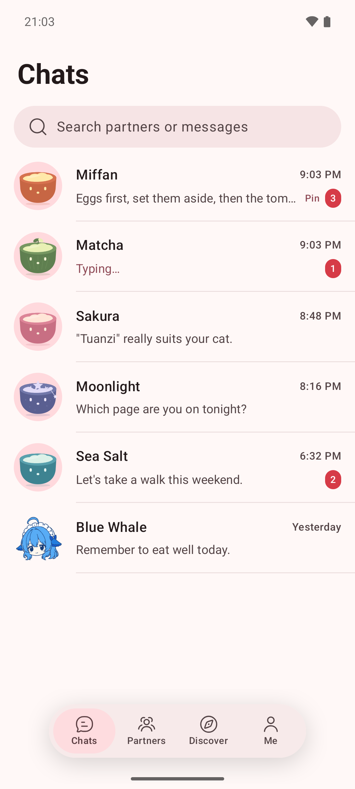
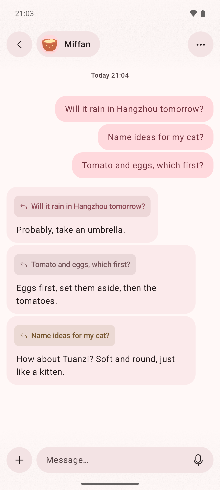
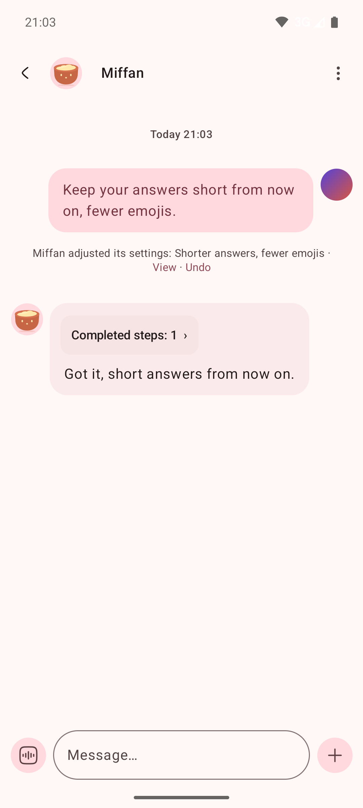
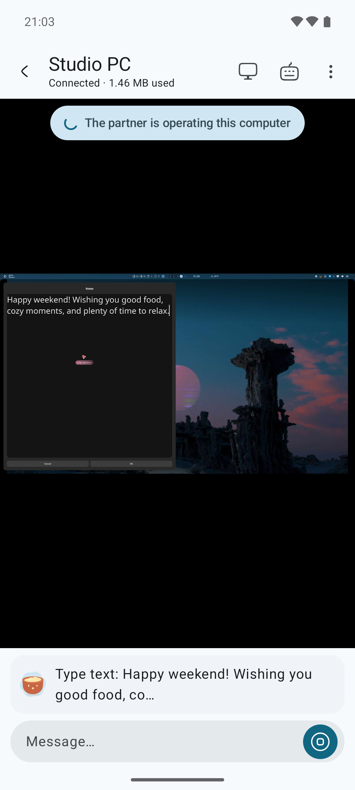
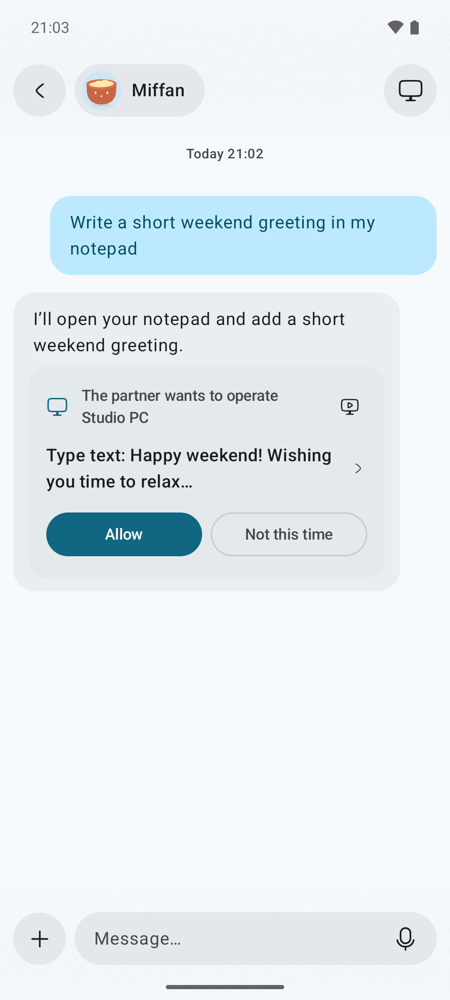
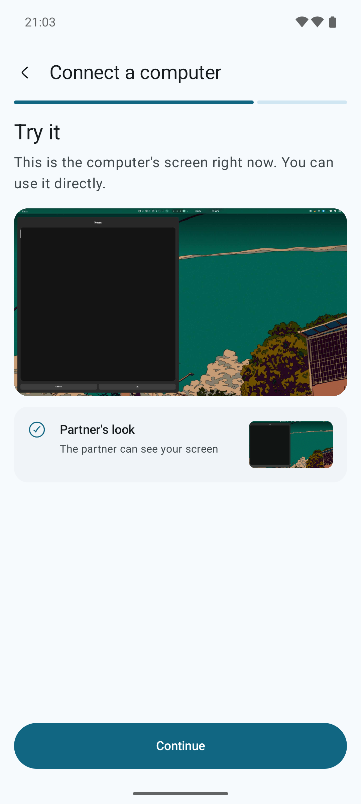

<div align="center">
  
  <h1>Miffan</h1>
  <p>An Android AI app you talk to like a friend, with partners that team up and can work on your computer.</p>

  <p>
    <a href="https://github.com/Ayuilos/Miffan/releases"></a>
    
    <a href="LICENSE"></a>
  </p>

  <p>English · <a href="README_ZH_CN.md">简体中文</a> · <a href="README_ZH_TW.md">繁體中文</a></p>
</div>

<table>
  <tr>
    <td align="center" valign="top"></td>
    <td align="center" valign="top"></td>
    <td align="center" valign="top"></td>
  </tr>
</table>

Bring the AI service you already use, whether that's an API key for an OpenAI-compatible, Gemini or Claude service, a ChatGPT subscription through Codex sign-in, or an OpenRouter account. Miffan doesn't bundle a model. Your chats and settings stay on your phone.

## Chat like a messenger

Each AI partner is one ongoing chat. There's nothing to start, no model to pick and nothing to tune.

- **One partner, one conversation.** Your history with a partner reads as one timeline across days. Behind the scenes Miffan keeps topics apart, so long chats stay quick and on point. A divider shows where a new topic began, and one tap continues the last topic instead.
- **Ask several things at once.** Unrelated questions run in parallel, and each reply quotes the message it answers.
- **Change a partner by telling it.** "Keep your answers shorter" adjusts its preferences. With your approval a partner can also change its own name, avatar and instructions. Every change is linked to the message behind it, kept in a history and can be undone.
- **See what AI knows about you.** Each memory shows where it came from, and you can delete it at any time.
- **Ask for a picture.** Pick a drawing model once and any partner can draw, or edit its last picture when you say "change it to…".

## Partners that work together

Partners can message each other, and you can bring several into one chat.

- **Group chats.** A host partner splits the work, mentioned partners reply at the same time, and you're notified only when someone mentions you.
- **Mention anyone.** Type @ in a chat to bring in another partner.
- **Your chat list, your way.** Pin partners, sort them into groups, and see at a glance who's working (green) or waiting for your approval (blinking amber).
- **Kept apart.** A partner only recalls chats it took part in, and first contact between two partners needs your OK.

## Let your partner use your computer

Connect a Mac, Windows or Linux computer over SSH, including over Tailscale, and your partner can open apps, type and click on it while you watch from your phone. A server or NAS without a screen works too: the partner uses it through commands.

- **One shared screen.** View and control the desktop from your phone, in portrait or full-screen landscape. Touch the screen and you take over right away.
- **High-performance mode.** With Sunshine on the computer, the graphics card encodes the picture for lower latency, smoother motion and sound. Miffan sets it up and pairs for you.
- **You stay in charge.** Choose per computer whether the partner asks first, works on its own or leaves it alone. Each approval is recorded in a permission history that stays even if you delete the chat.
- **Easy to connect.** Easy chat finds computers on your Wi-Fi and on Tailscale. Sign in once with the account password and Miffan switches to its own key; Windows gets a one-step setup script.

<table>
  <tr>
    <td align="center" valign="top"></td>
    <td align="center" valign="top"></td>
    <td align="center" valign="top"></td>
  </tr>
  <tr>
    <td align="center">Watch it work</td>
    <td align="center">Approve each step</td>
    <td align="center">Connect in a few steps</td>
  </tr>
</table>

Supported desktops: macOS, Windows, and Linux with GNOME, KDE (through their built-in remote desktop), wlroots-based Wayland (such as niri, Sway or Hyprland) or X11.

## Approve with a tap

When a partner wants to do something that matters, such as running a command, adding a calendar event or calling an MCP tool, it asks with a card you can read: one sentence on what it wants to do and the key details, with the raw call one tap away.

- Allow several ordinary requests at once, or always allow a kind of action and take that back later in the permission history.
- Adjust a calendar event's time before it's added.
- When a partner has a question, tap an option or write your own answer.
- Open any finished change to see exactly what it did, then undo or redo just that change.

## Professional mode when you want every option

Switch to the professional interface at any time. It uses the same data as easy chat.

- Combine official APIs, compatible gateways, self-hosted endpoints and a Codex subscription.
- Give each assistant its own prompts, model parameters, memory, MCP servers, Skills and web search.
- Run a local Linux workspace on the phone, or let assistants work on remote servers over SSH with files and a terminal.
- Use voice input and output, translate selected text in any app, and chat from a browser on your network.

The [feature matrix](docs/FEATURE_MATRIX.md) lists every supported provider, search service, speech engine and tool.

## Characters with feelings

<p align="center">
  
</p>

Choose a Miffan rice bowl or the blue whale girl. Their expressions follow the conversation: they eat while you wait, get dizzy while the AI reasons, smile when a reply arrives and doze off at night.

## Get started

1. Download the latest APK from [GitHub Releases](https://github.com/Ayuilos/Miffan/releases). Official builds are for `arm64-v8a` devices on Android 8.0 or later. Later updates download and install from inside the app.
2. On first launch, connect an AI service with an API key or sign in with a supported account.
3. Start chatting.

The [user guide](https://miffan.ayuilos.me/docs/en) walks through each feature. If something goes wrong, add the Bug reporter partner: it helps you narrow the problem down and writes it up as an issue for you to submit.

You can back up to WebDAV or S3-compatible storage, and import data from RikkaHub, Chatbox and Cherry Studio. Prompts, attachments and tool data go only to the services you configure; see [PRIVACY.md](PRIVACY.md) and [SECURITY.md](SECURITY.md).

## Project history

Miffan started as a fork of [RikkaHub](https://github.com/rikkahub/rikkahub), an open-source Android LLM client, and has since grown into an independent app.

| When | Release | What changed |
| --- | --- | --- |
| Aug 2026 | 2.4.10-miffan.1 | Forked from RikkaHub 2.4.10 and renamed Miffan, with its own app ID so it installs alongside RikkaHub. Added ChatGPT subscription sign-in through Codex. |
| Aug 2026 | 2.4.10-miffan.5 | The animated Miffan bowl characters arrived. |
| Aug 2026 | 3.0.0 | Moved to Miffan's own version numbers, independent of RikkaHub releases. |
| Sep 2026 | 3.1 – 3.3 | First-run setup, encrypted credentials, persistent reply branches and the blue whale girl. |
| Sep 2026 | 3.4 | Remote SSH workspaces. |
| Oct 2026 | 4.0 | Easy chat and letting your partner use your computer. |
| Oct 2026 | 4.1 | High-performance mode for the remote screen, and GNOME and KDE desktops. |
| Oct 2026 | 4.2 | Partner chats and groups, Windows computers and servers without a screen. |
| Oct 2026 | 4.3 | Drawing, a redesigned way to connect a computer, and readable approval cards. |

Miffan still takes in selected RikkaHub improvements. Each one is reviewed and listed separately in the release notes (see the [upstream sync policy](docs/upstream-sync.md)). Upstream copyright and attribution are kept as the license requires. Miffan is not an official RikkaHub release.

## Build and contribute

You need JDK 17, the Android SDK with NDK 28.2.13676358 and CMake 3.22.1, Node.js with pnpm, and Python 3.

```bash
git clone --recurse-submodules https://github.com/Ayuilos/Miffan.git
cd Miffan
(cd web-ui && pnpm install)
rdp/scripts/fetch-sources.sh && rdp/scripts/build-native.sh   # FreeRDP and OpenSSL, once
stream/scripts/fetch-sources.sh                                # Moonlight sources, once
./gradlew assembleDebug
```

The app is written in Kotlin with Jetpack Compose. Read the [contribution guidelines](CONTRIBUTING.md) and [issue guidelines](docs/ISSUE_GUIDELINES.md) before opening a pull request. Release and signing steps are in [docs/releasing.md](docs/releasing.md).

Miffan is licensed under the [GNU Affero General Public License v3.0](LICENSE).
