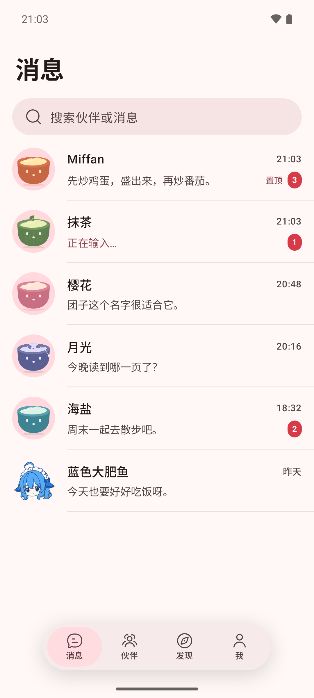
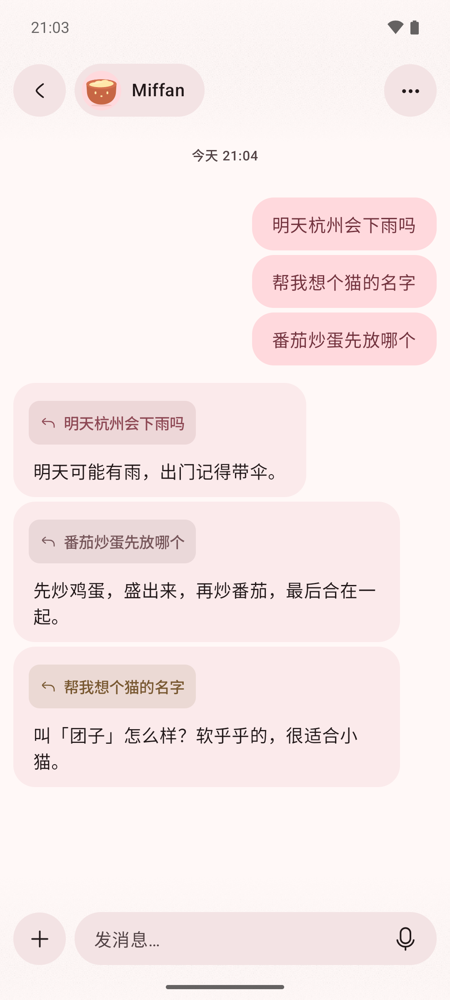
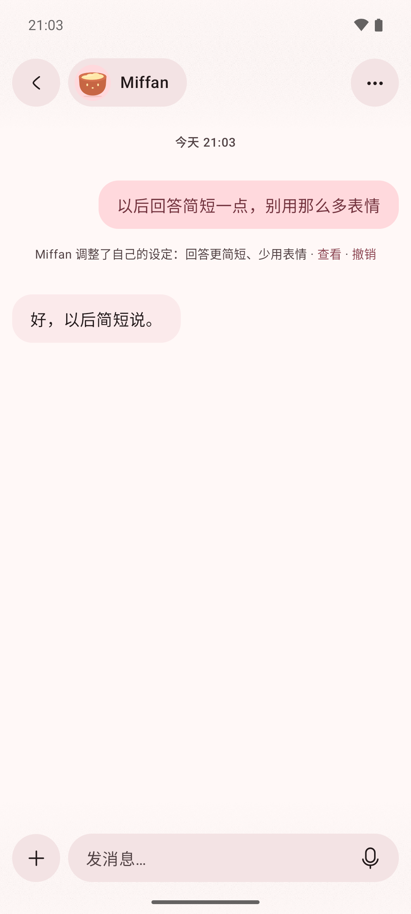
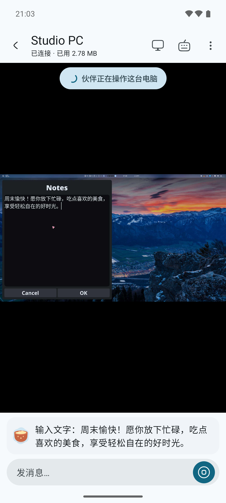
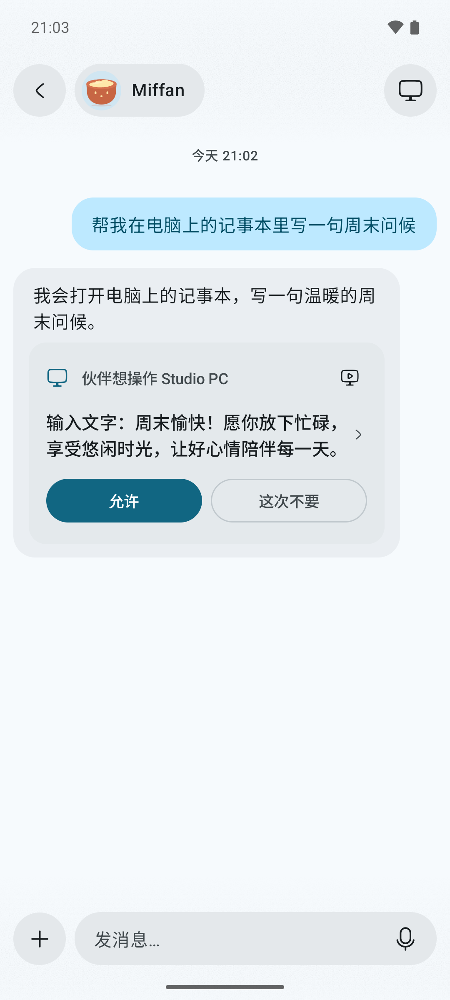
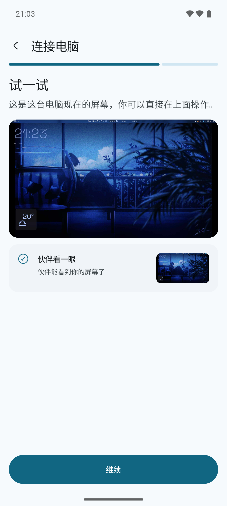

<div align="center">
  
  <h1>Miffan</h1>
  <p>像和朋友聊天一樣使用 AI 的 Android 應用程式：夥伴之間能分工合作，還能替你操作電腦。</p>

  <p>
    <a href="https://github.com/Ayuilos/Miffan/releases"></a>
    
    <a href="LICENSE"></a>
  </p>

  <p><a href="README.md">English</a> · <a href="README_ZH_CN.md">简体中文</a> · 繁體中文</p>
</div>

<table>
  <tr>
    <td align="center" valign="top"></td>
    <td align="center" valign="top"></td>
    <td align="center" valign="top"></td>
  </tr>
</table>

用你已經在用的 AI 服務就好：OpenAI 相容、Gemini 或 Claude 服務的 API Key，透過 Codex 登入的 ChatGPT 訂閱、OpenRouter 帳號，或是跑在你自己電腦上的 [Magpie](https://usemagpie.ai) 閘道。Miffan 不內建模型，聊天紀錄和設定都保存在你的手機上。

## 像傳訊息一樣聊天

每個 AI 夥伴就是一段持續的聊天。不用新增對話，不用選模型，也不用調參數。

- **一個夥伴，一段對話。** 和夥伴的聊天紀錄跨越多天也是一條時間軸。Miffan 會在背後把不同話題分開，長聊天依然又快又切題。新話題的起點會以分隔線標示，點一下就能改回接著上個話題聊。
- **同時問好幾件事。** 不相關的問題會並行回答，每則回覆都會引用它回答的那則訊息。
- **說一句話就能調整夥伴。** 例如「回答短一點」，夥伴就會調整自己的偏好。經你同意，夥伴還能修改自己的名字、頭像和設定。每次變更都關聯到引起它的那則訊息，保留在歷史紀錄裡，隨時可以復原。
- **看看 AI 記住了你什麼。** 每則記憶都能看到來源，隨時可以刪除。
- **想要圖片就說。** 選好一個繪圖模型，所有夥伴都能幫你畫圖；說一句「把它改成……」，就能接著修改上一張圖片。
- **重要的話收起來。** 長按一則訊息就能收藏。「發現」頁匯集收藏的訊息和最近的畫作，不找夥伴也能直接畫圖、翻譯。

## 夥伴之間合作

夥伴可以互相傳訊息，你也能把幾個夥伴加入同一個聊天。

- **群組聊天。** 主持的夥伴負責分工，被 @ 的夥伴同時回覆，只有 @ 到你時才會通知你。
- **隨時 @ 夥伴。** 在聊天裡輸入 @，就能叫上其他夥伴。
- **依你的習慣整理。** 置頂夥伴、分組整理，頭像上的狀態燈讓你一眼就能看出誰在工作（綠燈）、誰在等你核准（黃燈閃爍）。
- **彼此隔離。** 夥伴只能回顧自己參與過的聊天，兩個夥伴第一次聯繫也要先經你同意。

## 讓夥伴操作你的電腦

透過 SSH（包括 Tailscale）連接一台 Mac、Windows 或 Linux 電腦，夥伴就能在上面開啟應用程式、輸入文字、點擊按鈕，你在手機上看著它操作。沒有螢幕的伺服器或 NAS 也能連接，夥伴會透過指令來操作。

- **同一個畫面。** 在手機上查看並操作電腦桌面，直向或全螢幕橫向都可以，一碰螢幕就能立刻接管。
- **高效能模式。** 電腦上安裝 Sunshine 後，畫面由顯示卡編碼，延遲更低、更流暢，還能聽到電腦的聲音。設定和配對都由 Miffan 替你完成。
- **由你作主。** 每台電腦都可以選擇讓夥伴先問你、自動操作，或是完全不碰。每次核准都記在權限紀錄裡，刪除聊天也會保留。
- **排程任務。** 請夥伴「每天早上幫我做一件事」，電腦自己的排程器會準時執行，手機關機也不受影響（Mac 和 Linux）。任務可以是一道指令，也可以呼叫電腦上已安裝的 AI 工具，例如 Claude Code、Codex CLI 或 Gemini CLI。打開 Miffan 時結果會同步回聊天，「我的電腦」裡能看到每次執行的輸出。
- **連線很簡單。** 輕鬆模式會自動找到同一個 Wi-Fi 網路和 Tailscale 上的電腦。用帳號密碼登入一次，Miffan 就會改用自己的金鑰；Windows 電腦提供一鍵設定指令碼。

<table>
  <tr>
    <td align="center" valign="top"></td>
    <td align="center" valign="top"></td>
    <td align="center" valign="top"></td>
  </tr>
  <tr>
    <td align="center">看著它操作</td>
    <td align="center">每一步先問你</td>
    <td align="center">幾步就能連上</td>
  </tr>
</table>

支援的桌面：macOS、Windows，以及 Linux 上的 GNOME、KDE（透過系統內建的遠端桌面）、基於 wlroots 的 Wayland（如 niri、Sway、Hyprland）和 X11。

## 點一下就能核准

夥伴要做重要的事，例如執行指令、安排排程任務、新增行事曆活動或呼叫 MCP 工具時，會先傳來一張看得懂的卡片：用一句話說明它想做什麼，列出關鍵資訊，點一下就能展開原始呼叫內容。

- 幾個一般請求可以一次全部允許；某類操作也可以設為一律允許，之後隨時在權限紀錄裡收回。
- 新增行事曆活動前可以先調整時間。
- 夥伴向你提問時，可以點選一個選項，也可以自己寫回答。
- 開啟任一項已完成的變更，就能看到它具體改了什麼，並單獨復原或重做這一項。

## 需要時切換到專業模式

隨時可以切換到專業模式，它和輕鬆模式共用同一份資料。

- 混用官方 API、相容閘道、自架服務和 Codex 訂閱。
- 為每個助理分別設定提示詞、模型參數、記憶、MCP 伺服器、Skills 和網路搜尋。
- 在手機上執行本機 Linux 工作空間，或讓助理透過 SSH 在遠端伺服器上處理檔案、使用終端機。
- 語音輸入與朗讀、在任何應用程式中選取文字翻譯，還能在同一個網路裡用瀏覽器聊天。

完整的服務商、搜尋、語音和工具支援情況請見[功能矩陣](docs/FEATURE_MATRIX.md)。

## 有表情的角色

<p align="center">
  
</p>

每個夥伴都有自己的樣子：四種造型、六種配色的 Miffan 飯碗，藍色大肥魚，一張照片或一個表情，在「換個樣子」頁邊看即時預覽邊挑，Miffan 還能選它的動作性格。它們的表情會跟著對話變化：等待時吃飯，AI 思考時轉圈圈眼，回覆送達時露出笑容，夜裡還會打瞌睡。

## 開始使用

1. 從 [GitHub Releases](https://github.com/Ayuilos/Miffan/releases) 下載最新 APK。正式版適用於 Android 8.0 以上的 `arm64-v8a` 裝置。之後的更新可直接在應用程式內下載安裝。
2. 第一次開啟時，用 API Key 或支援的帳號連接一個 AI 服務。
3. 開始聊天。

[使用指南](https://miffan.ayuilos.me/docs)介紹了每項功能。遇到問題時，可以新增「反饋助手」夥伴：它會幫你找出問題，並整理成問題回報，由你提交。

資料可以備份到 WebDAV 或 S3 相容儲存空間，也可以從 RikkaHub、Chatbox 和 Cherry Studio 匯入。提示詞、附件和工具資料只會傳送給你設定的服務，詳見 [PRIVACY.md](PRIVACY.md) 和 [SECURITY.md](SECURITY.md)。

## 專案歷史

Miffan 最初是開源 Android LLM 用戶端 [RikkaHub](https://github.com/rikkahub/rikkahub) 的一個 fork，後來逐漸發展成獨立的應用程式。

| 時間 | 版本 | 變化 |
| --- | --- | --- |
| 2026 年 8 月 | 2.4.10-miffan.1 | 基於 RikkaHub 2.4.10 分出，更名為 Miffan，並使用獨立的應用程式 ID，可與 RikkaHub 同時安裝。新增透過 Codex 登入 ChatGPT 訂閱。 |
| 2026 年 8 月 | 2.4.10-miffan.5 | 加入會動的 Miffan 飯碗角色。 |
| 2026 年 8 月 | 3.0.0 | 改用 Miffan 自己的版本號，不再跟隨 RikkaHub 的版本。 |
| 2026 年 9 月 | 3.1 – 3.3 | 首次設定引導、憑證加密、持久保存的回覆分支，以及藍色大肥魚。 |
| 2026 年 9 月 | 3.4 | 遠端 SSH 工作空間。 |
| 2026 年 10 月 | 4.0 | 輕鬆模式，以及讓夥伴操作你的電腦。 |
| 2026 年 10 月 | 4.1 | 遠端螢幕的高效能模式，並支援 GNOME 和 KDE 桌面。 |
| 2026 年 10 月 | 4.2 | 夥伴私聊和群組聊天，支援 Windows 電腦和沒有螢幕的伺服器。 |
| 2026 年 10 月 | 4.3 | 繪圖、重新設計的電腦連線流程，以及看得懂的核准卡片。 |
| 2026 年 10 月 | 4.4 | 由電腦自己準時執行的排程任務，手機關機也不受影響。 |
| 2026 年 10 月 | 4.5 | 輕鬆模式改版：夥伴、「我」和「發現」頁，「換個樣子」頁，訊息收藏，以及 Magpie 閘道。 |

Miffan 仍會選擇性吸收 RikkaHub 的改進，每一項都經過審查，並在發布說明中單獨列出（見[上游同步策略](docs/upstream-sync.md)）。專案依照授權條款保留上游的著作權與署名資訊。Miffan 不是 RikkaHub 的官方版本。

## 建置與參與貢獻

需要 JDK 17、含 NDK 28.2.13676358 和 CMake 3.22.1 的 Android SDK、Node.js 與 pnpm，以及 Python 3。

```bash
git clone --recurse-submodules https://github.com/Ayuilos/Miffan.git
cd Miffan
(cd web-ui && pnpm install)
rdp/scripts/fetch-sources.sh && rdp/scripts/build-native.sh   # FreeRDP 和 OpenSSL，只需一次
stream/scripts/fetch-sources.sh                                # Moonlight 原始碼，只需一次
./gradlew assembleDebug
```

應用程式使用 Kotlin 和 Jetpack Compose 編寫。提交 PR 前請先閱讀[貢獻指南](CONTRIBUTING.md)和 [Issue 指南](docs/ISSUE_GUIDELINES.md)。發布與簽署流程請見 [docs/releasing.md](docs/releasing.md)。

Miffan 以 [GNU Affero General Public License v3.0](LICENSE) 授權發布。
