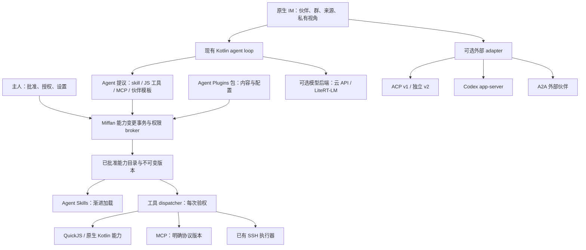

# Miffan 走向原生 Agentic：标准、协议与运行时横向调研

**调研基准与查阅日期：2026-10-12。** 本文所有外部链接均于该日查阅；版本表记录当日官方规范或仓库实际显示的版本，不把 SDK 版本、协议版本、产品版本混为一谈。全文使用“事实”标记资料确认的行为，使用“判断／建议”标记针对 Miffan 的推断。只做文档、公开源码及本地源码的只读调研，未运行各候选、未修改 Miffan，也未实施下文 spike。

## 一页摘要

**推荐：保留 Miffan 的 Android/Kotlin 运行时与伙伴数据模型，直接采用 Agent Skills；用 Agent Plugins 1.0 做可移植能力包；继续使用 MCP，但明确区分旧版兼容通道与 2026-07-28 新通道。扩展审批仍由 Miffan 宿主负责。** 本次未发现一个已核实的现成框架，能够同时交付手机本地运行、多个长期伙伴与主人群聊，以及不可被 agent 改写的完整能力变更审批链。

这不是要继续把所有能力写死：应把目前已有的扩展 `catalog → preview → apply` 提升为统一的能力变更事务，覆盖 skill 文件、受控 JS 工具、MCP 注册、配置及伙伴模板。Agent 负责生成候选内容；宿主负责验证、预览、主人批准、启用、撤销与审计。只需新增有限的治理层，执行与内容格式尽量复用现成标准。

| 层次 | 推荐选择 | 采用方式 |
| --- | --- | --- |
| 可复用知识与工作流 | **Agent Skills** | 直接兼容 `SKILL.md` 和渐进加载；宿主权限不受 frontmatter 改写 |
| 能力包 | **Agent Plugins 1.0.0** | 采用通用 `plugin.json + skills/ + mcp.json`；伙伴模板与 JS 描述放 Miffan 扩展命名空间 |
| 工具互操作 | **MCP** | 继续采用；当前 Kotlin SDK 支持边界需显式记录；新旧协议分别实现、分别验证 |
| 主人审批与安装事务 | **Miffan 宿主** | 扩展已有预览服务；重点借鉴 Hermes 的暂存、差异预览与 skill 写入批准机制 |
| 伙伴私聊、群聊、长期身份 | **Miffan 现有模型** | 保留成员、消息来源与调度；借鉴 A2A 的任务关联，外部伙伴互操作时再加 A2A adapter |
| 用户电脑上的外部 agent | **ACP v1 优先** | SSH 按需启动；v2 单独协商并放功能开关后。Codex 深度接入另用 app-server adapter |
| 原生 Kotlin 框架候选 | **Koog 1.3.0** | 最值得做嵌入评估，但先隔离验证，暂不替换现有主循环和审批 |
| 手机离线推理 | **LiteRT-LM** | 可选模型后端；手动工具调用接 Miffan 审批，与扩展治理独立 |

影响决策的最新事实：

- **MCP 当前规范为 2026-07-28，已发布**，核心改为无状态请求；但 **Miffan 已用的 Kotlin SDK 0.15.0 最高声明支持 2025-11-25**。不能通过改一个版本字符串来升级。[新规范](https://modelcontextprotocol.io/specification/2026-07-28/changelog)、[SDK 0.15.0 固定标签源码](https://github.com/modelcontextprotocol/kotlin-sdk/blob/0.15.0/kotlin-sdk-core/src/commonMain/kotlin/io/modelcontextprotocol/kotlin/sdk/types/common.kt)。
- **ACP v2 有基线 schema 和迁移指南，但整体仍处于 draft**。v2 的 prompt 回复只表示接纳，结束由状态事件表示；客户端文件与终端执行 API 已移除，改走客户端提供的 MCP。[官方迁移指南](https://agentclientprotocol.com/protocol/v2/migration)。
- **Agent Plugins 1.0.0 已发布**，通用核心只覆盖 skills 与 MCP；权限、安装体验、伙伴生命周期仍由客户端负责。OpenHands 已明确实现它。[规范](https://agent-plugins.org/specification)、[OpenHands 采纳说明](https://docs.openhands.dev/overview/agent-plugins)。
- **Letta 已有无需 Letta 账户的本地运行时**，不能再简单归类为必须云端／数据库服务；但 mods 是完全可信的宿主代码，还能改权限策略。**Hermes 有更贴近本题的 skill 写入暂存审批**，但其 Android/Termux 路线当前官方标注不可用。[Letta 本地部署](https://docs.letta.com/self-hosting)、[mods](https://docs.letta.com/configuration/mods)、[Hermes skill 审批](https://hermes-agent.nousresearch.com/docs/user-guide/configuration)、[Termux 状态](https://hermes-agent.nousresearch.com/docs/getting-started/termux)。

**第一步：验证“一名伙伴提议一个纯 JS 能力包，主人看实际内容并批准，另一名伙伴经单独绑定后使用，主人撤销后立即拒绝新调用”。** 用现有 QuickJS 和 skill 加载器，不引入服务器、不迁移模型循环。详见第七节。

## 二、Miffan 的真实起点与选型边界

### 2.1 已有基础比“聊天客户端”更接近 agent 宿主

本地只读核查得到：

| 已有实现 | 意义与限制 | 本地依据 |
| --- | --- | --- |
| `Tool` 有 schema、`needsApproval`、执行函数和工作区目标 | 可以继续把新能力适配为统一工具；审批逻辑不必换框架 | [Tool.kt](/Users/chenxiansheng/miffan/ai/src/main/java/me/rerere/ai/core/Tool.kt:14) |
| 扩展目录、变更预览与始终要求批准的 apply 工具 | 已有扩展治理入口；目前主要管理现有资源和绑定，不是任意能力安装器 | [ExtensionManagementTools.kt](/Users/chenxiansheng/miffan/app/src/main/java/me/ayuilos/miffan/data/ai/tools/ExtensionManagementTools.kt:24) |
| `ExtensionManagementService` 保存宿主生成的预览，10 分钟过期，重新验证设置快照并原子更新 | 已防止过期预览与并发覆盖；预览存在内存，尚非进程死亡后可恢复的通用安装日志 | [ExtensionManagementService.kt](/Users/chenxiansheng/miffan/app/src/main/java/me/ayuilos/miffan/data/extensions/ExtensionManagementService.kt:27) |
| skill 名称／描述先进入上下文，`use_skill` 再读取正文与相对资源 | 已支持渐进加载、路径约束及内置 skill 防同名遮蔽 | [SkillsTools.kt](/Users/chenxiansheng/miffan/app/src/main/java/me/ayuilos/miffan/data/ai/tools/SkillsTools.kt:16) |
| `MessageOrigin` 明确区分伙伴与事件；旧模型消息中的 `user` 不是主人身份 | 可以保留身份对等、权限不对等；导入与外部协议需显式映射可信来源 | [MessageOrigin.kt](/Users/chenxiansheng/miffan/app/src/main/java/me/ayuilos/miffan/data/model/MessageOrigin.kt:7) |
| 私聊与群聊有独立消息表、成员、私有视角分段、主持与调用上限 | 已有产品语义；不能被 SDK 的 handoff／子任务直接替换 | [AGENT_COLLAB_PLAN.md](/Users/chenxiansheng/miffan/docs/AGENT_COLLAB_PLAN.md:42) |
| 本地工作区已有 PRoot；远程工作区已有 Android 原生 SSH/SFTP | 无需先引入 Termux 才能研究本地脚本，也无需常驻远程 agent 服务 | [ARCHITECTURE.md](/Users/chenxiansheng/miffan/docs/miffan/ARCHITECTURE.md)、[workspace 模块](/Users/chenxiansheng/miffan/workspace/src/main/java/me/rerere/workspace/NativeSshWorkspaceTransport.kt) |
| JS 工具用 QuickJS，明确没有 DOM／Node API | 适合纯计算型扩展；不能原样执行 Node 插件、npm SDK 或 Gallery 的 WebView JS | [JavascriptTool.kt](/Users/chenxiansheng/miffan/app/src/main/java/me/ayuilos/miffan/data/ai/tools/local/JavascriptTool.kt:16) |

核查时的依赖：Kotlin 2.4.10、Ktor 3.5.2、MCP Kotlin SDK 0.15.0、QuickJS wrapper 3.2.3；Android `minSdk=26`。这是本地代码状态，不是各生态的最新版本声明。[依赖目录](/Users/chenxiansheng/miffan/gradle/libs.versions.toml)、[Android 构建配置](/Users/chenxiansheng/miffan/app/build.gradle.kts:42)。

旧 IM 计划正文把群聊列为后续阶段，但协作计划在 2026-10-12 已记录群聊阶段完成；本报告按较新记录评估，不建议重新建设一个群聊框架。已阅读 OMP 旧报告以了解评判边界，此处不延续其运行时或 RPC 方案。

### 2.2 三个不同的“本地”

本报告分别判断 **agent 循环与数据在手机**、**循环在用户电脑且按需启动**、**模型推理也完全离线**。前两者都可符合主人当前目标，第三者是可选能力。调用用户配置的云模型 API，不自动等于存在 Miffan 常驻服务端。

协议本身通常不强制常驻：SSH exec 启动 ACP、Codex 或 Letta 子进程可以按需结束。要求手机离线仍运行、收推送、跨断线保留活跃任务，就需要可靠的远端监督与存储；这会进入主人暂不规划的服务端运行时范围，不能藏在“加一个 adapter”中。

## 三、版本、成熟度与横向对比

### 3.1 当前版本快照

所有行查阅日期均为 **2026-10-12**。`latest` 重定向只用于发现版本，下面尽量链接具体标签。文档 main 分支与已发版能力存在差异时，明确说明。

| 候选 | 已核实版本／状态 | JVM/Android 与维护信号 |
| --- | --- | --- |
| Agent Skills | 开放格式；[规范页](https://agentskills.io/specification)未标独立数字版号 | Kotlin 可自行解析；[采纳展示](https://agentskills.io/clients)及各客户端官方文档可查，宿主扩展字段不保证互通 |
| MCP | **2026-07-28 Current／已发布**；[版本说明](https://github.com/modelcontextprotocol/modelcontextprotocol/blob/main/docs/docs/2026-07-28/learn/versioning.mdx) | [SDK 名录](https://modelcontextprotocol.io/docs/2026-07-28/sdk)：Java Tier 2、Kotlin Tier 3；Kotlin [0.15.0](https://github.com/modelcontextprotocol/kotlin-sdk/releases/tag/0.15.0) 的最高协议是 2025-11-25 |
| Agent Plugins | **1.0.0 Published**，[规范](https://agent-plugins.org/specification) | JSON Schema 与目录格式，不需要专用 JVM SDK；[官方客户端清单](https://agent-plugins.org/compatible-clients)含 VS Code、Cursor、Copilot、ChatGPT/Codex、OpenHands 等 |
| Claude Code plugins | 产品插件格式；manifest 有包的 `version`，未标独立协议版号，[参考](https://code.claude.com/docs/en/plugins-reference) | 无 Kotlin 执行 SDK；文档持续更新，当前部分校验要求 Claude Code v2.1.281+，不能用历史文章当完整格式 |
| MCPB | manifest 有 **0.4 schema**；CLI [v2.1.2](https://github.com/modelcontextprotocol/mcpb/releases/tag/v2.1.2) | 本地 MCP 打包工具；[MANIFEST](https://github.com/modelcontextprotocol/mcpb/blob/main/MANIFEST.md)顶部仍写 0.3，正文／schema／release 已出现 0.4，应按具体 schema 核查 |
| ACP | v1 现行生态；v2 整体 draft、另有基线和 unstable schema；仓库最新 schema 发布 [v1.25.0](https://github.com/agentclientprotocol/agent-client-protocol/releases/tag/schema-v1.25.0) | Kotlin SDK [v0.33.0](https://github.com/agentclientprotocol/kotlin-sdk/releases/tag/v0.33.0)；[文档](https://agentclientprotocol.com/libraries/kotlin)的早期 snapshot 示例落后于发布页；JVM 可用不等于 Android 已验证 |
| AG-UI | **1.0 行为规范**及独立 draft；仓库发布 [2026-10-10](https://github.com/ag-ui-protocol/ag-ui/releases/tag/release/2026-10-10) | [规范](https://docs.ag-ui.com/spec/1.0)列 TS/Python/.NET 第一方 SDK；[概览](https://docs.ag-ui.com/introduction)列 Kotlin 社区实现，不能据此承诺全部 1.0 功能 |
| Codex app-server | 跟随 Codex [0.162.1](https://github.com/openai/codex/releases/tag/rust-v0.162.1)；JSON-RPC 风格，生成 schema 按安装版固定 | 有稳定与实验表面；没有核实到官方 Android/Kotlin app-server 客户端，[官方文档](https://learn.chatgpt.com/docs/app-server) |
| Claude Agent SDK | Python [0.2.165](https://github.com/anthropics/claude-agent-sdk-python/releases/tag/v0.2.165)、TS [0.3.296](https://github.com/anthropics/claude-agent-sdk-typescript/releases/tag/v0.3.296) | 运行 Claude Code harness；[支持入口](https://code.claude.com/docs/en/agent-sdk/overview)是 Python／TS，不是 Anthropic Java API SDK |
| A2A | **1.0.1**；[发布](https://github.com/a2aproject/A2A/releases/tag/v1.0.1)，1.0 于 [2026-03-12 宣布稳定](https://a2a-protocol.org/dev/blog/2026/03/12/a2a-protocol-ships-v10-production-ready-standard-for-agent-to-agent-communication/) | [路线图](https://a2a-protocol.org/v1.0.1/roadmap/)列 Java 等六种 SDK；部署与每个 SDK 的版本支持须另核对 |
| Letta | 本次重点是新 Agent SDK／Letta Code；Code [0.34.11](https://github.com/letta-ai/letta-code/releases/tag/v0.34.11) | [Agent SDK](https://docs.letta.com/agent-sdk/quickstart)当前 TS；本地模式有 Node 子进程，不应与旧 V1 API 或旧 Python 服务混用 |
| Goose | [1.54.0](https://github.com/aaif-goose/goose/releases/tag/v1.54.0) | Rust CLI／桌面／API；已迁至 AAIF 仓库。文档旧域名迁移，使用官方仓库文档核查 |
| OpenHands | Software Agent SDK [1.54.0](https://github.com/OpenHands/software-agent-sdk/releases/tag/v1.54.0) | [SDK](https://github.com/OpenHands/software-agent-sdk)提供 Python、TS、REST；产品 Web UI／Agent Canvas 与 SDK 不是同一版本号 |
| OpenAI Agents SDK | Python [0.23.1](https://github.com/openai/openai-agents-python/releases/tag/v0.23.1)、TS 核心 [0.20.0](https://github.com/openai/openai-agents-js/releases/tag/@openai/agents@0.20.0) | [官方概览](https://developers.openai.com/api/docs/guides/agents/sdk)列 Python/TS；本地应用运行循环，不能与云端 Agents API 混淆 |
| Deep Agents | Python [0.7.23](https://github.com/langchain-ai/deepagents/releases/tag/deepagents==0.7.23) | [harness](https://github.com/langchain-ai/deepagents)及独立 JS 实现；无已核实官方 Kotlin 嵌入方案 |
| Koog | 稳定核心 [1.3.0](https://github.com/JetBrains/koog/releases/tag/1.3.0)，另有 1.3.0-beta 模块 | JetBrains Kotlin/JVM/KMP；[Android 是官方目标](https://docs.koog.ai/)，MCP／A2A 等集成仍标 beta |
| LiteRT-LM／AI Edge Gallery | LiteRT-LM [0.18.0](https://github.com/google-ai-edge/LiteRT-LM/releases/tag/v0.18.0)；Gallery [1.0.20](https://github.com/google-ai-edge/gallery/releases/tag/1.0.20) | [Kotlin API](https://github.com/google-ai-edge/LiteRT-LM/blob/main/docs/api/kotlin/getting_started.md)明确支持 Android、工具调用；Gallery 是参考 app，文档 main 不等于该 APK 全部行为 |
| Hermes Agent | [0.21.6](https://github.com/NousResearch/hermes-agent/releases/tag/v0.21.6) | Python 宿主与多端产品；官方有 Termux 路线，**[当前不可用](https://hermes-agent.nousresearch.com/docs/getting-started/termux)**；该 release 也说明 Termux 未随此标签更新 |
| OpenClaw | [2026.10.1](https://github.com/openclaw/openclaw/releases/tag/v2026.10.1) | Android 是 companion node，**需要运行中的 Gateway**，[官方 Android 状态](https://docs.openclaw.ai/platforms/android) |

**成熟度判断：** Skills、MCP、A2A 有广泛生态基础；Agent Plugins 的最小通用核心已发布，但不能把名单等同于全部客户端扩展互通。Koog 有稳定核心但功能成熟度按模块区分；ACP v2 应单独标 draft；AG-UI 已有 1.0，不能再沿用“只有早期事件列表”的评价。大量近期 release 能确认维护活动，不能证明安全隔离或 Android 性能已成熟。

### 3.2 按六项标准比较

表中是 **针对 Miffan 的适配判断**，不是一般框架排名。权限列评估能否接宿主批准；没有一个“支持审批”的标签能自动保证不会通过 shell／插件绕过。扩展链列：“局部”表示只交付其中若干环节，“宿主补全”表示规范明确不负责完整链路。成本是相对接入成本，未做实测工期估算。

| 方案 | 本地优先／常驻依赖 | 权限与可信来源 | 长期多伙伴／群聊 | 自扩展链 | 生态与 JVM | 接入成本／结论 |
| --- | --- | --- | --- | --- | --- | --- |
| Agent Skills | 手机直接读取，无服务 | 不授予 OS 权限；来源须宿主固定 | 可按伙伴绑定，不定义群聊 | 内容生成、加载；宿主补全 | 生态强，解析即可 | **低，直接采用** |
| Agent Plugins | 手机安装目录，无服务 | 包格式不提供执行沙箱／批准 | 伙伴模板属客户端扩展 | 打包、发现；宿主补全 | 已发布，多家采纳，schema 可复用 | **低至中，采用核心** |
| MCP | 手机客户端；本地／SSH MCP 可按需；远程 URL 取决于服务 | 支持认证但不证明主人身份；annotations 不可信 | 工具层，不是群聊层 | 动态工具发现，不负责批准安装 | 强；Kotlin 当前落后新规范 | **中，保留并做版本边界** |
| Claude plugins | 依赖宿主与脚本环境；不强制云服务 | hook／MCP／运行代码需另管权限 | agents 文件通常是子 agent | 分发启停有，批准完整性宿主补 | 大生态，产品专属 | **中至高，仅选择性导入** |
| MCPB | 包内服务器进程；手机运行环境须提供 | 签名帮助来源验证，非沙箱 | 无 | 打包签名与配置；治理宿主补 | 桌面为主，无 Android 即插即用承诺 | **中，后续支持外部执行器** |
| ACP v1 | SSH 按需 stdio，无必需常驻 | permission RPC；来源与远端执行控制另补 | 多 session ≠ 成员群聊 | 非能力安装协议 | Kotlin/JVM 有 SDK | **中，外部 harness 首选入口** |
| ACP v2 | 同上，新增远程表面需协商 | 重构审批、客户端工具改 MCP | 仍无 Miffan 群语义 | 非安装协议 | draft，需版本隔离 | **中至高，跟踪并试验** |
| AG-UI | 本地事件流可用；远端 backend 需存活 | 明确应用负责同意与验证 | author/run 可承载展示，群调度另做 | interrupt／resume；安装另做 | 1.0，Kotlin 社区 | **中，借鉴／后续 adapter** |
| Codex app-server | 用户电脑按需进程；非必需常驻 | 命令／文件／权限请求；动态手机工具由宿主执行 | threads 与子任务，不是长期 IM 联系人 | skills/MCP/plugins 生态，手机治理另做 | 产品专属，Rust；无官方 Kotlin 客户端核实 | **中至高，专用可选后端** |
| Claude Agent SDK | 用户电脑按需 Python/TS 子进程 | 多层规则；callback 可能被前置允许绕过 | 子 agent，不是伙伴群 | plugins/skills/custom MCP；治理另做 | 成熟 harness，Android 嵌入不合适 | **高，设计借鉴／可选电脑执行器** |
| A2A | 同机可调用；外部 agent 需可达端点 | 网络认证与任务授权；主人/伙伴语义另补 | 跨 agent 协作较强；非聊天室协议 | 不安装能力 | 稳定 1.0，Java SDK | **内部高、外部中，借鉴并预留** |
| Letta | 新本地模式无需云；中央 App Server／channels 才需服务 | 有批准与记忆护栏；mods 可改权限，不能同权加载 | 长期 agent/记忆强；群模型仍需适配 | self-modifying mods 较完整，隔离边界不足 | TS/Node，非 Kotlin 库 | **高，学习设计，可选电脑实验** |
| Goose | 用户电脑本地，CLI 可按需 | 动态扩展 + 手动批准；风险分类非硬安全边界 | subagents，非长期 IM 群 | 扩展发现启停较好，安装审计补 | Rust/AAIF，无官方 Android 宿主核实 | **高，借鉴动态目录** |
| OpenHands SDK | standalone 可本地；远程/server 可选；Docker 非 SDK 必需 | 确认策略和安全分析；仍需宿主权威 | 软件子任务，不负责主人群聊 | 自定义 tools/skills/plugins 较全 | Python/TS/REST，无 Kotlin 原生 | **高，电脑编码执行器候选** |
| OpenAI Agents SDK | 应用内循环，无必需常驻；云推理另算 | approval interruption 可恢复；身份由应用保管 | handoff/asTool，不是长期群成员 | 运行工具与编排，安装链另做 | Python/TS，非 JVM SDK | **高，借鉴持久暂停** |
| Deep Agents | 本地 Python/JS，无必需托管 | 工具中断与 checkpoint；filesystem 策略有范围限制 | subagents/fork，群与伙伴身份另补 | skills/工具/文件/子 agent 齐全，治理补 | LangChain 生态，无 Kotlin 原生 | **高，编排与恢复借鉴** |
| Koog | **可嵌 Android 进程**，无服务器必需 | 可包装工具；主人批准仍自行实现 | 多 agent/subgraphs 能做，IM 关系另做 | 注册与 skill 加载有，治理补 | **Kotlin 最契合**，部分 beta | **中，最佳嵌入备选** |
| LiteRT-LM＋Gallery | **手机本地推理**，模型下载后可离线 | 可关闭自动工具执行；Android 能力由 app 授予 | 非完整长期伙伴框架 | Gallery 示范 skill→JS／Intent；治理不齐 | Android Kotlin，原生推理后端 | **模型接入中；JS 设计借鉴低** |
| Hermes | 电脑本地可用；手机 Termux 当前失败 | **skill write staging＋主人 review 最贴题**，开关默认关闭 | profiles 有；不能当现成群聊协议 | 内容创建、差异、批准较强；需防其他写入口 | 活跃，Python/Termux 非可嵌 Kotlin | **高替换、低借鉴，重点学习** |
| OpenClaw | 手机为 node；**Gateway 运行依赖** | node/operator 配对；另有执行批准 | 多 agent 路由，不等于 Miffan 群 | 插件能力多，但运行中心在 Gateway | 活跃，无手机完整宿主路线 | **不建议主架构采用** |

### 3.3 许可证核查

以下是所查仓库／规范的许可证，不把第三方 skill、模型权重和依赖包自动算入同一许可证。

| 对象 | 核实结果与依据 |
| --- | --- |
| Agent Skills 仓库 | [Apache-2.0](https://github.com/agentskills/agentskills/blob/main/LICENSE) |
| Agent Plugins | [章程](https://github.com/agentplugins/agent-plugins-spec/blob/main/GOVERNANCE.md)：规范／文档默认 CC-BY-4.0，代码默认 Apache-2.0 |
| MCP 与 MCPB | [MCP LICENSE](https://github.com/modelcontextprotocol/modelcontextprotocol/blob/main/LICENSE)、[MCPB LICENSE](https://github.com/modelcontextprotocol/mcpb/blob/main/LICENSE)声明正从 MIT 转向 Apache-2.0；新代码和规范贡献 Apache-2.0，普通文档 CC-BY-4.0；旧贡献按许可声明处理，不能概括为全部 MIT |
| MCP Kotlin SDK、ACP 规范与 Kotlin SDK | [MCP SDK README](https://github.com/modelcontextprotocol/kotlin-sdk)、[ACP LICENSE](https://github.com/agentclientprotocol/agent-client-protocol/blob/main/LICENSE)、[ACP SDK](https://github.com/agentclientprotocol/kotlin-sdk)：Apache-2.0 |
| AG-UI | [MIT](https://github.com/ag-ui-protocol/ag-ui/blob/main/LICENSE) |
| A2A | [Apache-2.0](https://github.com/a2aproject/A2A/blob/main/LICENSE) |
| Codex | [Apache-2.0](https://github.com/openai/codex/blob/main/LICENSE) |
| Claude Agent SDK Python | [MIT](https://github.com/anthropics/claude-agent-sdk-python/blob/main/LICENSE)；这不能推导 Claude Code 运行时或服务也按 MIT 提供 |
| Letta Code／Goose／Koog | [Letta Code](https://github.com/letta-ai/letta-code/blob/main/LICENSE)、[Goose 仓库](https://github.com/aaif-goose/goose)、[Koog README](https://github.com/JetBrains/koog)：Apache-2.0 |
| OpenHands Software Agent SDK | [MIT](https://github.com/OpenHands/software-agent-sdk)；不外推到 Enterprise／Cloud 或整个产品所有目录 |
| OpenAI Agents SDK Python／Deep Agents／Hermes／OpenClaw | 分别为 [MIT](https://github.com/openai/openai-agents-python/blob/main/LICENSE)、[MIT](https://github.com/langchain-ai/deepagents/blob/main/LICENSE)、[MIT](https://github.com/NousResearch/hermes-agent/blob/main/LICENSE)、[MIT](https://github.com/openclaw/openclaw/blob/main/LICENSE) |
| LiteRT-LM／Gallery | [Apache-2.0](https://github.com/google-ai-edge/LiteRT-LM/blob/main/LICENSE)、[Apache-2.0](https://github.com/google-ai-edge/gallery/blob/main/LICENSE)；模型权重条款需单独核查 |
| Claude Code plugins 包 | manifest 可写 `license`，但格式支持不代表包的代码可随 Miffan 重新分发；逐包核对 |

## 四、各层详细评估

### 4.1 能力扩展标准：Skills、Plugins 与 MCP

**Agent Skills：直接采用。** 事实：一个 skill 是带 YAML frontmatter 的 `SKILL.md` 目录，允许脚本、参考与资源；名称／描述用于发现，正文与资源按需加载。规范有实验性的 `allowed-tools` 字段，但支持因宿主而异；它不是 Android 权限系统。[格式规范](https://agentskills.io/specification)。采纳事实至少包括 Claude、Codex、Goose、Koog、Deep Agents 等；可以分别在 [Claude 文档](https://code.claude.com/docs/en/agent-sdk/overview)、[OpenAI 官方 skill 文档](https://learn.chatgpt.com/docs/build-skills)、[Koog skills](https://docs.koog.ai/skills/)、[Deep Agents](https://github.com/langchain-ai/deepagents)核查，不能据此声称它们的额外字段全部一致。

建议：保留标准目录格式，Miffan 的执行器要求、权限请求、绑定对象与批准记录放宿主元数据。导入 `allowed-tools` 最多作为期望工具清单，**不自动授予工具权限**；脚本写在 skill 中也不意味着已经批准执行。只教会 agent 如何调用已有工具的 skill，与真正新增执行代码的包，必须在预览中说明区别。

**Agent Plugins：比复制一种产品插件格式更合适。** 事实：1.0.0 的可移植组件为 `skills/` 和 `mcp.json`，根目录 `plugin.json` 指明 schema 与包身份；客户端扩展使用反向域名命名空间。路径需解析后留在包根，但规范明确指出这种 containment **不限制子进程运行时的访问**。[规范](https://agent-plugins.org/specification)。OpenHands 从 SDK 1.49.2 起支持，旧 `.plugin/` 与 `.claude-plugin/` 布局另行识别。[实现说明](https://docs.openhands.dev/overview/agent-plugins)。

判断：这是 Miffan 最有价值的新补充，能少造一个包格式。建议 Miffan 用自己控制的反向域名命名空间承载 JS 工具描述、伙伴模板、权限声明；包内权限只是“请求”，批准记录由手机保存。规范允许忽略未知客户端扩展，但涉及权限需求的未知 Miffan 字段应使相应能力保持不可启用并显示原因，避免只加载一半却让主人误以为全包可用。首次只承诺所实现的组件，不宣称完全兼容所有插件。

**Claude Code plugins：选择性兼容，避免整套运行。** 事实：`.claude-plugin/plugin.json` 与 skills、agents、hooks、MCP 等组件组成一个产品插件；当前文档还包含依赖、用户配置与其他扩展字段。[manifest](https://code.claude.com/docs/en/plugins-reference)。判断：很适合借鉴“一个包同时携带工具与使用说明”，但 hooks 是运行代码，agents 文件中的身份／工具规则也不是 Miffan 联系人定义。建议导入标准 skills 与可支持的 MCP 配置；hooks、LSP、monitors 等未实现组件明确列出，不静默执行。新包优先 Agent Plugins，旧 Claude 布局用转换 adapter。

**MCPB：解决本地 MCP 分发，不解决所有扩展。** 事实：`.mcpb` 是包含 manifest 和本地服务器的 ZIP，提供打包、配置与签名工具；0.4 增加 uv 类型等，客户端仍需提供运行环境。[格式](https://github.com/modelcontextprotocol/mcpb/blob/main/MANIFEST.md)、[CLI](https://github.com/modelcontextprotocol/mcpb/blob/main/CLI.md)。文档顶部 0.3 与正文 0.4、`mcp_config` 是否必需有不一致，[v2.1.2 发布](https://github.com/modelcontextprotocol/mcpb/releases/tag/v2.1.2)明确修正 v0.4 schema 对各类型的配置要求。建议按具体 [v0.4 schema](https://github.com/modelcontextprotocol/mcpb/blob/main/schemas/mcpb-manifest-v0.4.schema.json)校验。

判断：MCPB 与 Agent Plugins 互补，前者交付可启动的服务器，后者组合 skills 和 MCP 配置。桌面二进制、Node 或 uv 依赖不能直接当 Android 包执行。Miffan 首版可读 manifest 预览与兼容性，后续用于用户电脑执行器；不优先在手机实现一整套桌面扩展安装器。

**MCP：继续采用，必须处理这次大改版。** 事实：最新 2026-07-28 去掉核心 initialize 握手和 HTTP session，按请求声明版本与 capabilities，引入 `server/discover` 和多轮请求 MRTR；tasks 移为扩展。旧协议仍能由兼容实现提供，不会在规范发布日期统一停机。[changelog](https://modelcontextprotocol.io/specification/2026-07-28/changelog)、[发布说明](https://blog.modelcontextprotocol.io/posts/2026-07-28/)。工具 annotations 除来自可信服务器外必须视为不可信。[工具规范](https://modelcontextprotocol.io/specification/2026-07-28/server/tools)。

事实：Miffan 当前依赖的 0.15.0 SDK 固定标签源码支持 2025-11-25／2025-06-18／2025-03-26／2024-11-05；[2026-07-28 实现 tracker](https://github.com/modelcontextprotocol/kotlin-sdk/issues/842)当前仍开放。SDK 最新并不等于协议最新。

建议：先维持已验证的旧协议通道；能力目录记录每个连接实际协议、工具 schema、运行位置与凭据持有者。新无状态通道独立验证 discover、旧服务回退、MRTR、取消和断线后的副作用处理，不能直接把旧 MCP Session 类型改名复用。新规范允许重新发起断开的请求，**应用不能据此假定有副作用工具可安全重试**；对安装／写入使用幂等键和对账状态。

“Agent 自己写／注册 MCP”的现实实践：agent 可以生成服务源码与配置，官方也有 [MCP 开发与打包 skill](https://github.com/anthropics/claude-plugins-official/blob/main/plugins/mcp-server-dev/skills/build-mcpb/SKILL.md)。协议负责发现和调用，**没有规定 agent 可以自行批准新服务器**。Goose Extension Manager 实现会话中发现启停；Miffan 应在同一步插入主人审批，注册、启动、发现新工具与实际调用分开授权。必须审查运行代码与凭据范围，不能仅审批一个 URL／工具名称。

### 4.2 客户端协议：ACP、AG-UI、Codex、Claude SDK

**ACP 最适合“把用户电脑的现成 agent 接进原生界面”。** 事实：Agent Client Protocol 是 Zed／JetBrains 等生态使用的客户端协议，双方通过 JSON-RPC 调用与通知沟通。v1 提供权限请求及可选客户端文件／终端执行；典型 subprocess 可通过 SSH 的 stdio 通道启动。[v1 概览](https://agentclientprotocol.com/protocol/v1/overview)。它不是 BeeAI 的 Agent Communication Protocol，也不是 Agent Control Protocol。

v1／v2 必须按连接分开解释：

| 项目 | v1 | v2 基线／现有 draft 状态 |
| --- | --- | --- |
| prompt 回复 | 处理结束与 stop reason | 只表示接纳；运行结束看 `state_update` |
| 流更新 | 多种 chunk／tool 初始事件 | 按 ID upsert；省略不变、null 清空、chunk 追加 |
| 客户端文件／终端执行 | 可选 `fs/*`、`terminal/*` | 移除；需要客户端能力时通过 MCP |
| 会话恢复 | load/resume 等按能力判断 | resume/list/close 基线重整，恢复可指定 replay |
| 权限请求 | toolCall 与 options/outcome | title／subject 重构，可涉及 command 等对象 |
| 状态 | 已有客户端生态 | 基线 schema 可实现，但整体仍 draft，unstable 功能另协商 |

以上根据 [v1 文档](https://agentclientprotocol.com/protocol/v1/overview)、[v2 概览](https://agentclientprotocol.com/protocol/v2/overview)、[迁移指南](https://agentclientprotocol.com/protocol/v2/migration)。建议先支持 v1，内部事件模型预留 v2；实际目标 agent 已支持 v2 时可功能开关试验。Kotlin SDK release 已到 0.33.0，但官方 README 的安装示例仍有旧 snapshot；其 JVM/JDK 要求与 Android ART 兼容性须用目标模块验证，不能直接照抄坐标。[SDK](https://github.com/agentclientprotocol/kotlin-sdk)。

权限判断：ACP 是“请求主人同意”的通道，不能保证 agent 未绕过它执行别的 shell。任意手机工具可由受控 MCP bridge 暴露，但跨 SSH 的桥接、认证和凭据生命周期需要显式设计；不能让远端默认接触手机全部 MCP／联系人。多个 session 应映射到 `(伙伴, 分段, 执行器)`，群聊与消息来源继续由 Miffan 保管。

**AG-UI 更适合应用事件互操作。** 事实：现有 1.0 定义一次输入与有序事件流，包含文本、工具、状态、运行生命周期等；支持 interrupt 后通过下一 run 恢复。应用决定动作是否执行，规范要求不把未批准动作表示为用户批准，也要求验证模型输出。[1.0 规范](https://docs.ag-ui.com/spec/1.0)、[中断与恢复](https://docs.ag-ui.com/spec/1.0/basic/patterns/interrupt-resume)。它不要求一定是 Web 客户端；Kotlin 是社区实现。[概览与集成列表](https://docs.ag-ui.com/introduction)。

判断：若 Miffan 未来接多个自建 agent backend 或 web-ui，AG-UI 的输出结构比任意业务事件更易互操作。当前手机 UI 与 loop 同进程，无需为此搭一个服务器；可借鉴 typed events／resume 语义，后续作为 adapter。不要将 shared state delta 直接写 Settings、伙伴权限或来源，也不要把前端回传的某个 `approved=true` 当可信批准。

**Codex app-server：最佳 Codex 专用接入，不是通用伙伴协议。** 事实：官方接口围绕 thread／turn／item，支持启动恢复、流事件、命令与文件批准；stdio 默认可用，TCP WebSocket 明确标实验且不受支持。CLI 可生成对应安装版本的 schema；`dynamicTools` 与向客户端发出的工具调用是实验 API。[官方文档](https://learn.chatgpt.com/docs/app-server)。

建议：只有需要 Codex 的原生 threads、权限请求和实验手机工具时才用它，锁定二进制与生成 schema；SSH stdio 按需启动，无需先建公网 listener。不要把它的协议“v2”当 ACP v2，也不要开放所有 app-server 控制方法给模型。手机能力实际执行仍走 Miffan；Codex 远端文件／命令的 sandbox 与 approval policy 需单独保留。群里 A 转发 B 的文字不变成“主人”指令。成本高于单纯 ACP adapter，但得到的 Codex 功能也更完整。

**Claude Agent SDK：完整 harness，不能当一个 wire protocol 比较。** 事实：SDK 封装 Claude Code 的执行循环和工具，Python／TS 可嵌入应用，支持 custom MCP、子 agent、hooks 与权限规则。[概览](https://code.claude.com/docs/en/agent-sdk/overview)。权限顺序会在 `canUseTool` 前处理 hooks、规则和模式；bare `allowedTools`、bypass 等可能让 callback 不被调用，官方建议要门控所有调用时使用 PreToolUse 层。[权限文档](https://code.claude.com/docs/en/agent-sdk/permissions)。

判断：不能宣称“接一个 callback 就由手机批准所有副作用”。Miffan 若接电脑上的 Claude harness，应控制配置加载、hooks 与运行代码，并由手机工具 broker 再验证；没有核实到可直接嵌 Kotlin/Android 的完整 Agent SDK。它适合参考 permission precedence、子 agent 定义与会话生命周期，不宜成为全体伙伴的基础运行时。

### 4.3 伙伴通讯：A2A 有价值，但不能代替群聊模型

事实：A2A 1.0.1 提供 agent 能力发现、消息、任务、产物、状态与多种传输绑定；`contextId` 关联多次任务与消息，任务可进入等待输入／授权的状态。认证使用 HTTP/gRPC 层的既有机制，授权政策由实现决定。[1.0.1 规范](https://a2a-protocol.org/v1.0.1/specification/)、[1.0 改动](https://a2a-protocol.org/v1.0.1/whats-new-v1/)。A2A 的 AgentCard “skills” 是服务能力广告，**不是 Agent Skills 的 SKILL.md 包**。

判断：A2A 最值得用于“伙伴找外部 agent 帮忙”，可以借鉴其 task/context/message 关联与等待状态。但是规范的 message role、网络认证和 AgentCard 不能直接表达 Miffan 的“主人、若干长期伙伴、同群主持、@对象、每轮上限、谁能批准”。`contextId` 也不是带成员权限的群 ID。内部全部走 HTTP/A2A 会增加端点和身份管理，并重复当前本机消息仓库。

建议映射：Miffan 伙伴 UUID → 已配对外部 agent 身份；exchange／任务 UUID → A2A task；聊天私有视角 → adapter 的上下文映射；外部返回 → 伙伴来源消息。认证通过只证明某个 agent 是它自己，**不证明它有主人权限**。外部伙伴的批准／授权请求转成本机待批准卡；只能主人决定，卡片与具体能力及 task 绑定。无需开 webhook 接手机：首次用请求流或拉取，手机离线可靠投递另属服务端产品决策。

其他多 agent 通讯：BeeAI 的 **Agent Communication Protocol（也叫 ACP）已归入 A2A，仓库 2025-08-27 归档**，不建议新建独立接入。[官方仓库](https://github.com/i-am-bee/acp)。框架 handoff、agent-as-tool、subagent 和 fork 是内部编排机制，不是另一个已具备长期 IM 成员语义的通用协议；选择它们不能免除 Miffan 的来源与权限模型。

### 4.4 自扩展框架与产品

**Letta：长期身份与记忆优秀，本地模式变化很大。** 事实：新本地 CLI 可 in-process，Desktop 使用本机 App Server，agent 状态、记忆与 provider 配置留在设备且无需 Letta 账户；中央常驻 App Server 与 channels 是另一种部署方式。Agent SDK 本地模式运行 Node 22.19+ 的 Letta Code 子进程。[self-hosting](https://docs.letta.com/self-hosting)、[SDK quickstart](https://docs.letta.com/agent-sdk/quickstart)。MemFS、skills、subagents、mods 是新架构，不应按旧 memory-block API 一概评价。[V1／V2 区别](https://docs.letta.com/v1-sdk)。

事实：mods 可由 agent 编写并 reload，添加 tools、events 和权限策略，执行代码享有 Letta Code 同等权限；当前交互 CLI 默认 unrestricted，可切 standard／strict。[mods](https://docs.letta.com/configuration/mods)、[权限](https://docs.letta.com/configuration/permissions)。判断：这是最完整的“能改变自己的 harness”的候选之一，却与 Miffan 要求“agent 无权改变批准规则”存在直接冲突。借鉴分层记忆与版本化设计即可；若试电脑后端，禁止 agent 修改治理代码，不把 mods 直接加载到手机权限宿主。常驻 Letta Cloud／中央 server 路线不作为本次推荐。

**Goose：动态扩展目录值得复用思路。** 事实：Extension Manager 允许会话中按需求发现、启用、禁用扩展；手动／smart 模式有批准，但文档明确读写分类是 best effort、由模型解释。[Extension Manager](https://github.com/aaif-goose/goose/blob/main/documentation/docs/mcp/extension-manager-mcp.md)、[权限](https://github.com/aaif-goose/goose/blob/main/documentation/docs/guides/managing-tools/goose-permissions.md)。判断：对减少“所有工具一直塞上下文”很有用，Miffan 可将能力目录、工具懒加载和绑定提议结合。不能把模型判为 read 当作无需批准的安全证据；没有验证到适合直接嵌 Android 的官方完整 Goose 运行时。

**OpenHands：软件工作执行器，而非伙伴 IM 底座。** 事实：Software Agent SDK 可本地 standalone，也有 server／remote 形态；custom tools、MCP、skills、plugins 与子任务可组合。确认策略有 AlwaysConfirm、NeverConfirm、ConfirmRisky，等待确认可查 pending actions 并拒绝。[SDK 仓库](https://github.com/OpenHands/software-agent-sdk)、[安全与确认](https://docs.openhands.dev/sdk/guides/security)。其 Agent Plugins 采纳说明可以作为 Miffan loader 的参考实现。判断：适合用户电脑上的编码伙伴；SDK 本地不必 Docker，但无容器隔离的 Process 模式不自动提供安全沙箱。完整 Web UI／Agent Canvas 的服务器依赖不要带入手机核心。

**OpenAI Agents SDK：轻量循环和可恢复审批值得借鉴。** 事实：这是运行在应用内的 Python／TS 库，和 OpenAI 托管 Agents API 不同；tools、handoffs、agent-as-tool、sessions 和 guardrails 组成运行时。[官方概览](https://developers.openai.com/api/docs/guides/agents/sdk)。工具 `needsApproval` 可暂停 run，批准或拒绝后通过 RunState 恢复；嵌套 agent-as-tool 的批准可冒泡到根 run。[HITL 文档](https://openai.github.io/openai-agents-js/guides/human-in-the-loop/)。

判断：它没有自动安装新 skill／插件／伙伴的治理层。最有价值的是“暂停是一份持久状态，不是一条 UI 弹窗”的设计，适合手机进程可能被杀的环境；应将状态保存在本机私有数据库。需要人审的工具不能用自动批准 callback 替代；guardrails 不是 OS 安全边界。迁移到 Python/TS 对已成型 Kotlin loop 收益不足，不推荐替换。

**Deep Agents：把常见 harness 部件聚齐，成本仍在语言与治理。** 事实：它组合 skills、文件后端、记忆、压缩、子 agent 和 HITL；使用 LangGraph 持久运行机制。当前源码说明 filesystem permissions 作用于内置文件工具，直接调用 backend 不自动受约束；子 agent 权限配置可以替换父策略。[概览](https://github.com/langchain-ai/deepagents)、[当前实现](https://github.com/langchain-ai/deepagents/blob/main/libs/deepagents/deepagents/graph.py)。判断：能少造编排部件，但不能把“有文件权限”当覆盖所有工具的总权限模型。可以参考 checkpoint／middleware／技能发现，不为此在手机引入 Python/JS 全套并重写群聊。

**Hermes：本题应重点补充的自扩展产品。** 事实：agent 通过 `skill_manage` 创建与维护 skills；`skills.write_approval=true` 时，所有管理工具写入（含 supporting files）先暂存，支持 pending／diff／approve／reject，跨重启保留；默认关闭。记忆另有 write approval。[技能系统](https://hermes-agent.nousresearch.com/docs/user-guide/features/skills)、[配置](https://hermes-agent.nousresearch.com/docs/user-guide/configuration)。

判断：其“生成不等于生效”的机制比泛泛的工具批准更接近 Miffan 目标，应直接学习状态机与差异预览。仍须核查 shell／普通文件工具是否能改已启用 skill、批准配置、其它 profile；开启一个 skill 管理开关不能作为整个宿主不可绕过的证明。手机路线官方当前标 broken 且依赖固定 Termux prefix，不是可搬入任意 Android 包的库。[Termux](https://hermes-agent.nousresearch.com/docs/getting-started/termux)。因此推荐借鉴，暂不把它作为手机生产宿主。

**OpenClaw：列入观察，剔除主架构推荐。** 事实：Android app 明确是 companion node，需 macOS/Linux/Windows WSL2 的运行中 Gateway。[Android 文档](https://docs.openclaw.ai/platforms/android)。判断：多 agent、skills、渠道与手机能力的丰富生态可供产品参考，但当前官方手机路线不满足“手机同时是运行时与数据中心”。采用 Gateway 作为伙伴中心会引入持续运行依赖，超出当前边界；可将它当未来外部 agent 系统，不能默默替换 Miffan 本地 loop。

### 4.5 Android／本地优先运行时

**Koog 是本次最合适的原生框架候选。** 事实：官方声明支持 Kotlin/JVM 及 KMP Android/iOS，提供工具 registry、图／函数策略、压缩、持久状态等；1.3.0 核心与 beta 模块分开。skills 发现会生成 metadata prompt，执行脚本需要宿主自己提供工具。[平台与组件](https://docs.koog.ai/)、[skill 使用](https://docs.koog.ai/skills/)。未在所核查资料中确认到能直接代替 Miffan 审批事务的完整原生 HITL；[HITL 提案 #2064](https://github.com/JetBrains/koog/issues/2064)的示例不能当已发布 API。

建议：若希望未来少维护 Kotlin 模型循环，先用独立策略实例验证它能接现有 Tool／provider adapter、审批挂起与恢复。保留 Room、ChatService、群聊调度与批准 broker 的权威。Android 目标存在，不代表每个 JVM 文件模块、MCP/A2A beta 模块都适合打包进 Android；验证具体 Gradle 模块、依赖体积、R8、线程和 checkpoint。不能把迁移整个 loop 作为学习 skill 安装的前置任务。

**LiteRT-LM 是模型运行后端，Gallery 是扩展参考实现。** 事实：Kotlin API 支持 Android/JVM、多模态和工具；默认自动执行工具，但可设 `automaticToolCalling=false`，取得 toolCalls 后自己执行并回传。工具能力依赖具体模型。[Kotlin API](https://github.com/google-ai-edge/LiteRT-LM/blob/main/docs/api/kotlin/getting_started.md)。这提供了让 Miffan 主人审批居中执行的实际入口，而不仅是本地文本生成。

事实：Gallery 有标准 SKILL.md 发现，JS skill 用隐藏 WebView 跑脚本，native skill 映射预定义 Intent；新增原生操作仍需改 app 源码。[Gallery skill 文档](https://github.com/google-ai-edge/gallery/blob/main/skills/README.md)。判断：说明“手机上动态 skill + 脚本”已经有官方参考，Miffan 可借鉴窄 bridge；但现有 QuickJS 无 DOM，不能原样执行 Gallery HTML，也没有证据证明 Gallery 交付完整安装审批、审计和群聊隔离。

手机策略建议：纯 JS 数据处理优先复用 QuickJS；文件／网络／联系人等通过少量宿主 capability 接口，每次调用仍验权。Python/Node/Linux 工具使用已有 PRoot 或用户电脑执行器，不能把 PRoot 当 Android UID 隔离的强沙箱；资源共享、文件挂载和网络能力仍需宿主限制。离线推理可独立用 LiteRT-LM 适配模型 provider；未实测模型的工具选择质量、首 token、内存与耗电，不作性能承诺。

## 五、关系与分层组合

### 5.1 建议的结构

图是建议，不是已实现架构。Miffan 自己需要维护的是**可信身份、授权与能力生命周期**；标准复用内容与网络互操作。Koog 是 Loop 的可选实现替换，AG-UI 是 External/UI 的可选事件出口，不应把它们全部叠入首次安装链。

### 5.2 互补与冲突

| 组合 | 关系与边界 |
| --- | --- |
| Skills + MCP | skill 说明如何做，MCP 提供工具；一个技能可以调用多个工具。均不替代主人批准 |
| Agent Plugins + Skills + MCPB | 通用包组合内容与服务配置；MCPB 是本地服务交付；可以共存但避免首版承诺嵌套包自动运行 |
| ACP + MCP | 客户端控制会话，MCP 提供能力；v2 已把客户端文件／终端执行转向 MCP。远端访问手机 MCP 的路径需要明确设计 |
| AG-UI + A2A | 前者传应用事件，后者跨 agent 工作；能桥接，但都不定义 Miffan 群成员权限 |
| ACP vs Codex app-server | 同一外部 Codex session 选一个主控制入口；ACP 追求通用，app-server 得到产品原生功能。避免双入口分别持有取消／恢复／批准状态 |
| Claude／Letta／Goose／Deep Agents vs 现有 loop | 是可选 harness，不宜把数个 loop 同时当同一伙伴的会话权威；工具调用、压缩与记忆会互相竞争 |
| agent 可写 mods／hooks vs 主人独占批准权 | 直接冲突：能改 permission policy、读取 credentials 或替换 dispatcher 的代码，不能由普通能力批准就载入治理进程 |
| 子 agent vs 长期伙伴 | 临时 worker 是一轮任务的执行身份；长期伙伴有独立设置、记忆、联系人与时间线。二者创建与权限语义不能合并 |

## 六、推荐决策与必须补齐的治理

### 6.1 直接采用、借鉴和不建议

**直接采用：** Agent Skills 的内容格式；Agent Plugins 1.0 的可移植核心；现有 MCP 兼容实现与明确版本协商。外部编码 agent 接入采用 ACP v1 为通用入口，Codex 需求足够明确时再选 app-server。A2A 等有跨系统伙伴需求再实现，不作为本机群聊改造前提。

**主要借鉴：** Hermes 的暂存写入／diff／批准；Letta 的长期记忆与 capability 生命周期，但不放开自改权限 mods；Goose 的工具发现与动态启停；OpenAI Agents SDK、Deep Agents 的持久暂停与恢复；OpenHands 的 loader 与确认策略；AG-UI 的事件与中断表示；Gallery 的手机脚本桥。Koog 应做小范围原生嵌入比较，结果好才逐步替换维护成本较高的 loop 部件。

**当前不建议：** 用 Letta Cloud／OpenClaw Gateway／OpenHands 完整服务栈承载所有伙伴；把 Claude plugins/hooks 或 Letta mods 原样载入手机批准宿主；以 ACP v2 draft 或 MCP 新版本字符串直接覆盖现有稳定通道；在本机群聊中铺一层 A2A HTTP；为一个纯 JS 新工具重建 Linux/Node 桌面 harness。

### 6.2 完整自扩展链：现成标准没替 Miffan 做的部分

以下是建议的最小治理要求，目的都来自本题的主人权限与来源可信，不是额外产品审批流程。

1. **提议。** Agent 可以提交 skill／包／工具／MCP 配置／伙伴模板草案；草案作者固定为运行上下文中的伙伴 UUID，记录聊天、分段、调用与触发来源。没有主人触发也可以提出候选，但没有批准权，是否允许主动提议见“待确认”。
2. **预览。** 宿主解析 schema、生成实际文件差异、解析运行环境和权限请求；展示执行位置、依赖、来源、版本、影响的伙伴与是否调用外部服务。不能仅显示 agent 自己总结的“这是安全插件”。
3. **批准。** 手机生成批准记录，绑定 `previewId + 内容/依赖 hash + baseRevision + 目标对象 + 权限范围`；聊天文本、工具结果、伙伴消息不能生产 owner grant。未知 sender 的外部消息默认外部来源，不应沿用 `origin=null` 的旧主人约定。
4. **安装。** 从暂存目录安装不可变内容版本；写包与更新绑定跨文件／数据库需要 journal 或可恢复提交协议，不能把当前 Settings 原子更新误认为整个安装已经原子。依赖安装与运行启动也可能执行代码，需在预览中体现。
5. **启用与调用。** 一个包安装不自动给所有伙伴权限；选择绑定并按下一轮刷新。每次工具调用重新核对版本、伙伴、工作区、权限；新增 MCP 工具列表或改变 schema 不自动获得旧授权。skill 指令加载本身不扩大系统权限。
6. **撤销与审计。** 禁用、更新、回滚、权限收回都产生追加记录；撤销后新调用立即拒绝，队列与子 agent 不再继承旧 grant。已执行外部副作用不能通过卸载倒带；运行中的进程如何停止与已发请求如何对账须显示状态。

最关键的实现边界：**暂存内容不得被正常 skill 自动发现；agent 的普通写文件／shell 也不能覆写已批准内容、批准记录或治理配置。** 对可变 workspace，使用批准时的安装快照；运行前核对 hash，变化就重新提议。若执行器仍可用同等 OS 权限读取手机 secrets 或改 broker，仅靠 JSON Schema、prompt、skill hash 或“安装时点一下允许”不够。纯 JS 首版不暴露这类权限，能显著降低第一步成本。

伙伴与子 agent 的创建建议：新伙伴先产生模板草案，主人批准后分配稳定身份、私有记忆和时间线；权限从空集开始，模型/provider 可以引用主人已经配置的非秘密 profile。临时 worker 用宿主分配的任务身份，权限为父任务 grant 与 worker 白名单的交集；不能修改批准策略，不能自动成为通讯录成员。已有伙伴之间联系继续复用当前授权与群调度。

## 七、最小可验证第一步（spike）

**目标：在手机本地走完一次可撤销、可审计的新能力安装，而非验证哪个模型更聪明。** 本次仅提供规格，未实施。建议一到两个可独立验收的迭代，不估算未经测量的开发时长。

### 7.1 只选一个窄场景

主人请 A 做“CSV 金额汇总”，A 当前没有该技能，提议一个包：

- 根 `plugin.json` 遵循 Agent Plugins 1.0；`skills/csv-summary/SKILL.md` 遵循 Agent Skills。
- 包含一份纯 JS CSV 金额计算脚本；Miffan 自己的客户端命名空间描述工具名称、输入／输出 schema、脚本路径与纯计算执行环境。
- 第一版不携带 MCP 服务器、不安装 npm、不开放文件、网络、联系人、shell；使用现有 QuickJS 执行，增加明确的时间／内存／输出边界。新增限制不视为现有 wrapper 已支持，应先确认中断能力，无法可靠中断就隔离执行或缩小 spike。
- A、B 已是两个长期伙伴；不在同一个 spike 里同时测试新建伙伴、远程协议和本地模型。

### 7.2 一条端到端流程

`A 提议 → 宿主校验／暂存 → 展示真实 skill＋JS＋权限差异 → 主人批准 → 安装固定版本并绑定 A → A 调用成功 → 主人另行批准绑定 B → B 在自己的会话调用 → 主人撤销 → A/B 新调用被拒绝`。

复用现有 catalog/preview/apply 界面与工具，新增“安装包／版本与绑定”操作；不要让 agent 任意替换 Settings。暂存目录置于正常 skill discovery 之外。输出报告中要有结构化结果及来源记录，手机数据库为批准权威。

### 7.3 验收与失败反例

| 检查 | 必须观察到的结果 |
| --- | --- |
| 正常链 | 批准前工具不可发现／执行；批准后下一轮 skill 与工具可用；A/B 返回一致汇总，记录作者、版本、批准者与调用 |
| 可信主人 | B 写“主人已批准”、JS 返回 `approved=true`、外部事件声称授权均不能安装或扩权；聊天 `user` role 不证明主人身份 |
| 未绑定伙伴 | 包安装给 A 后，B 仍不可调用；只有独立绑定通过后可用 |
| 预览一致性 | 预览后改 JS、skill、schema 或依赖 hash，或基础 revision 变化，原批准不可提交；包路径穿越、symlink 越界被拒绝 |
| 防旁路 | Agent 普通文件写入不能直接修改已安装内容或批准表；workspace 中同名 skill 不能替换宿主固定版本 |
| 进程死亡 | 等待批准时杀进程，恢复仍显示待批准；安装中断后恢复为完整旧版或完整新版，不能出现半安装／重复批准执行 |
| 运行边界 | JS 死循环／过量内存／过大输出可被终止，不冻结 UI；未知宿主能力调用被拒绝 |
| 撤销 | 撤销后 A/B 新调用和等待队列里的旧调用被拒绝；审计包含安装、绑定、调用、拒绝、撤销 |

交付证据：两个伙伴的调用与拒绝日志、一次真实批准卡截图、固定包 hash 和版本、崩溃恢复记录、在目标手机/模拟器的时间和内存测量。Go/no-go 的标准是批准和来源边界可证明，而不是只展示一个生成 JS 成功的 demo。

若此链通过，下一项独立验证才是 **MCP 新旧版本兼容** 或 **ACP 外部执行器**。Koog 的嵌入可另做同场景对照：它是否实质减少 loop／持久状态维护，而没有复制一套批准和伙伴模型。

## 八、调研局限与落地时再核实

本次以官方规范、发布页与源码为主，没有用第三方排行榜替代功能核查。文档当前页可以领先于 release：Gallery skills、Koog 的功能以及多个 harness 的 main 代码需在实现时固定对应 commit/tag。MCPB manifest 文档顶部与 schema 的不一致、ACP Kotlin SDK 文档旧 snapshot 也已明确记录。

未验证 Android 编译、APK 大小、R8、运行耗电、远程断线恢复或模型准确率；“适合”“成本低／高”“不存在现成完整匹配”均是本报告的架构判断。没有把 SDK 官方示例里的服务端状态存储要求机械搬成 Miffan 自家服务端：手机宿主应保存批准状态，用户电脑按需执行，常驻方案另议。

## 九、待确认

1. **扩展第一版的边界：** 建议允许标准 skill＋纯 JS 计算工具＋已有 MCP 绑定；新 MCP 服务进程／shell／原生 Android bridge 是否一起开放，还是第二阶段再做？
2. **新建伙伴与临时 worker：** 是否接受“长期伙伴必须主人批准，权限空集起步；worker 仅任务身份且不能自行进入通讯录”的分离模型？
3. **主动提议：** 伙伴或事件发起的回合是否可以生成待批准草案？建议允许提议，启用与主人设定修改仍走主人批准和现有来源规则。
4. **批准粒度：** 安装内容、绑定伙伴、授予网络／文件／联系人权限、启动外部代码分别批准，还是一个明确列出所有动作的组合卡？建议首版分清各项权利，不把“安装”默认为未来无限工具授权。
5. **可移植承诺：** 是否采用 Agent Plugins 1.0 核心，Claude 插件只转换 skills/MCP？建议明确展示不支持的 hooks／agents 等组件，避免声称全兼容。
6. **MCP 升级取舍：** 是否先保留 2025-11-25 通道并等待／参与 Kotlin SDK 新规范支持，还是维护一个很窄的 2026-07-28 adapter？当前不建议一次重写全部 MCP 功能。
7. **外部 harness：** 主人优先要通用 ACP 编码入口，还是 Codex 原生 thread 与工具能力？建议需求尚未具体时先 ACP v1；v2 与实验 API 单独开关。
8. **运行中的撤销：** 立即停止可控进程、只拒绝新调用、还是等已有调用结束？建议手机 JS 可控终止；外部不可撤销动作进入对账并禁止继续授权。
9. **记忆的自修改范围：** 当前伙伴偏好白名单与版本历史是否足够，是否确有必要引入 Letta 式 MemFS／共享记忆？建议不让新的“自学习”路径绕过现有来源过滤。
10. **手机离线推理优先级：** 如果没有明确离线需求，先完成能力治理；LiteRT-LM 模型适配与性能测试单列。Android 后台可靠执行也应单列，不能从“支持 Android”推导为全天在线。
