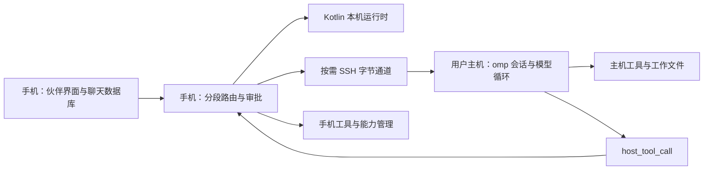

# oh-my-pi RPC 与 Miffan 原生 Agentic 架构调研

调研日期：2026-10-12。主要依据是本地源码快照：omp `5d0aaffaf1f987503ce129a642fb6e30339615af`，Pi `c661bc574f9e9713cc2af567fc1ac00621377a0c`；Miffan 只读参考快照为 `f69ee2d72e1cf7858b25c85112a69ab4c6d4aa47`。没有修改三个代码仓库，没有安装依赖、启动 agent 或调用付费模型。本报告是源码审阅与官方资料核对，运行效果留给 spike 验证。

下文 **事实** 表示源码或官方资料明确支持；**判断／建议** 表示结合 Miffan 约束的推断。源码引用使用文末的完整路径和链接，标明对应行号；`O`、`P`、`M` 分别指 omp、Pi、Miffan 源码根目录。

## 一页摘要

**推荐 C 为主线：保留 Kotlin 本机运行时，把 skill、能力提议、审批、注册、持久化和子任务生命周期做成可扩展机制；A 作为可选的用户自有主机接入；暂不把 B 纳入产品底座。** omp 可以复用为一个成熟度较高的桌面编码运行时，但不能直接替代 Miffan 的伙伴身份、多人聊天、主人授权与本地数据模型。这是架构判断，主要依据是 RPC 的单活动会话接口、子 agent 的授权方式，以及 Miffan 已有的私有视角分段和消息来源设计。[RPC 类型 L35–145][rpc-types] [子任务权限 L1124–1146][task-executor] [Miffan 协作 L42–76][m-collab]

| 方案 | 结论 | 主要代价／冲突 |
| --- | --- | --- |
| A：用户电脑／工作空间主机跑 omp | 技术上可行，适合独立的远程工作伙伴 | 推理、凭据、会话至少部分转到远端；需会话映射、手机工具桥、审批和重连适配。可以按需 SSH 启动，不必建设常驻服务 |
| B：Android 本机跑 omp | PRoot 内的技术实验值得保留；直接嵌入尚不能当成现成方案 | Bun 依赖、Rust/N-API 模块、系统能力、后台生命周期与包体；已有 PRoot 降低试验成本，但没有 omp Android 支持证据 |
| C：Kotlin 借鉴协议与扩展概念 | 最符合当前方向；大量现有能力可继续使用 | 仍要实现通用能力注册与审批机制；不能直接执行 omp 的 TypeScript 扩展 |

支撑方案评估的关键事实：

1. **RPC 是双向 stdio JSONL，自定义协议，不是 HTTP 服务，也不是 JSON-RPC 2.0。** 支持 prompt、流式消息、会话持久化与分支、队列、取消、子任务观察，以及客户端执行的 host tools。Miffan 已有无 PTY 的 SSH `openProcess()`，可直接承载这样的字节流。[RPC 输入 L46–64][rpc-input] [RPC 类型 L35–145、772–813][rpc-types] [SSH 进程通道 L371–385][m-ssh]
2. **“有审批”不等于“主人统一控制”。** 主会话工具审批默认 `yolo`；RPC 可通过扩展 UI 的 `select` 请求传出工具批准／拒绝，但它是通用 UI，缺少专门的结构化审批关联字段。子 agent 默认 headless + `yolo`，把批准父任务当作授权边界。普通工具事件只能观察，不能代替执行前 gate。[审批设置 L293–339][approval-settings] [工具 wrapper L317–420][ext-wrapper] [子任务权限 L1143–1146][task-executor]
3. **自扩展有实际边界。** agent 能写 skill、工具／扩展源码、任务定义；host tools 可由 RPC 客户端动态注册。但 RPC `/reload-plugins` 只刷新 skill 和文件命令；新扩展模块需要重启。`cfg://` 的受审批设置写入仅向交互主会话开放，RPC／ACP 默认被拒绝。项目扩展默认直接加载，没有逐项目信任 gate。[刷新 L1737–1742][rpc-mode] [新扩展 L4860–4894][sdk] [配置入口 L1–18、301–317][cfg] [项目信任 L658–665、722–732][ext-types]
4. **ACP 更适合未来的通用 agent 接入标准；omp RPC 更适合深入复用 omp。** omp 的 ACP 实现本身支持一个连接中的多个 session，审批也有 `session/request_permission`。但快照实现的是 ACP v1，不能直接使用网上 v2 的字段；ACP 也不提供 Miffan 多伙伴身份与统一扩展审批模型。[ACP 初始化 L612–677][acp-agent] [协议版本 L13][acp-protocol] [客户端桥 L25–69][acp-bridge]
5. **Bun 的 Android 情况已经变化。** 官方 2026-08-20 的 Bun 1.4 公告明确有 aarch64／x64 实验性 Android 构建，因此“Bun 完全不支持 Android”不成立；但 omp 的原生模块发布／构建目标仍只有 Linux、macOS、Windows。这只改善运行时前提，没有证明 omp 可直接在 Android 运行。[Bun 1.4 官方公告](https://bun.com/blog/bun-v1.4) [omp 原生目标 L51–78][native-build]

**最小第一步建议：做 C 的一个本机 skill 生命周期闭环**——伙伴提出一个新 skill，生成不可变预览，主人批准后安装到工作空间，下一轮可发现并调用，拒绝和过期预览不生效；整个过程有来源和版本记录。它直接验证“伙伴能扩展、主人能控制”，不要求更换推理循环。若随后要决定是否引入 omp，再做第 7 节规定的、无常驻服务的 SSH/RPC 小实验。

## 1. omp 是什么，和 Pi 有什么关系

### 1.1 关系与分层

**事实。** omp README 明确称其为 Mario Zechner 的 Pi 分叉，由 Stencil Labs 维护；快照包名为 `@oh-my-pi/pi-coding-agent`，版本 `18.10.1`。其目标是增加编码工作流能力，而不是一个 Android agent 框架。[README L22、131–137、569–585][o-readme] [包信息 L1–28][o-package]

| 层 | 主要源码／职责 | 对 Miffan 的意义 |
| --- | --- | --- |
| `packages/ai` | 多提供商模型请求、流、模型与内容类型 | 对应部分 `ai/` 能力；接入远程 omp 后模型请求由 omp 发起 |
| `packages/agent` | agent 状态、模型—工具循环、取消与生命周期事件 | 对应运行时核心，不包含完整伙伴／群聊产品模型 |
| `packages/coding-agent` 的 SDK／`AgentSession` | 上下文、工具发现、扩展、skill、重试、压缩、会话存储、任务运行 | 真正可复用的编码 harness；RPC 和 ACP 包装这一层 |
| TUI／一次性模式／RPC／ACP | 同一套运行时的不同入口；RPC 包装一个 `AgentSession`，ACP 创建和管理多个 session | RPC／ACP 不是另一套模型，也不是代理转发 Miffan 原有生成循环 |
| `packages/natives` + Rust crates | N-API 接入 shell、PTY、文件搜索、编辑、隔离、语音等原生能力 | Android 移植的重要额外依赖 |

依据：[包分层与 crates L649–680][o-readme]、[RPC runner L1326–1343][rpc-mode]、[ACP session map L612–627][acp-agent]、[CLI 分派 L2567–2577][main]。这里是逻辑分层；headless 代码仍引用部分 TUI 类型／组件，不能理解成完全独立、轻量的纯协议内核。

**事实。** 本次 Pi 快照仍自述为 minimal、extensible harness，也提供 SDK/RPC/扩展/skill，但已经使用 `@earendil-works/*` 包名，编码 agent 包版本为 `1.1.0`、Node 要求 `>=22.19.0`。不能拿旧博客中的 Pi 包名、版本或命令语义当作这两份快照的契约。[Pi README L15–21][p-readme] [Pi package L1–20、107–108][p-package]

### 1.2 实现、许可证与成熟度

**事实。** 控制逻辑主要为 TypeScript；omp CLI 的 shebang 是 Bun，RPC 输入直接使用 `Bun.stdin`，插件安装使用 `Bun.spawn`，原生包 engines 写 `bun >=1.3.14`。README 的 “Node SDK” 描述不足以证明当前整个 coding-agent 在普通 Node 上可无改动运行；Android 评估应以 Bun 依赖为准。预编译 CLI 可以把 Bun 打包进可执行文件，仍需匹配原生平台。[CLI L1][cli] [输入 L7–8][rpc-input] [原生包 L29–32、56–61][native-package] [插件安装 L33–64][plugin-installer] [README L498–554][o-readme]

**事实。** 仓库主许可证是 MIT，保留著作权与许可文本是其明确条件；README 同时指出第三方依赖／vendored 内容有各自许可和 notices。引入整个二进制应按实际打包依赖整理 notices，不能只复制根 LICENSE。[LICENSE L1–21][o-license] [README L695–699][o-readme]

**事实。** 本地浅克隆只有一个可见历史 commit，不能由 `git log` 计算长期提交频率。能确认的是：快照 HEAD 为 2026-10-12，changelog 在 10 月 11–12 日连续列出多个发布；10 月 12 日仍有 `RpcClient.stop()` 卡住的修复。RPC 具备语言中立 schema、Python／Rust／Go 生成客户端及生成一致性检查，也有针对 malformed input、审批 UI、host tools、取消、会话切换、分块传输的专项测试源码。[Changelog L5–64][changelog] [生成器 L1–9、24–32][gen-rpc] [RPC 测试目录][rpc-tests]

**判断。** 它已经超出简单原型，适合做受控集成实验；但快节奏迭代、近期生命周期修复和有限的功能协商意味着它不是无需维护的固定协议标准。本次未运行测试，不将“有测试”写成“当前全部通过”，也不推断 SLA、Android 稳定性或生态兼容保证。

## 2. 自有 RPC 协议：实际契约

### 2.1 启动、传输与版本

启动命令是 `omp --mode rpc`；若要 `ask` 等工具 UI 也经过客户端，使用 `omp --mode rpc-ui`。会话持久化测试应保留默认持久化，用 `--session-dir`／`--continue` 或运行后 `open_session`；`--no-session` 适合一次性实验，但不支持持久化恢复。`--no-ui` 让扩展 headless，不能用于需要扩展审批对话的集成。[CLI 分派 L2559–2577][main] [RPC 启动说明 L19–33][rpc-doc] [open_session L908–936][rpc-mode]

**事实。** stdin 输入一行一个 JSON 对象，stdout 输出响应和事件，stderr 是日志；没有端口监听、TLS、账户认证或伙伴权限握手。这里的登录命令是模型提供商登录，不是手机与主机间的传输认证。SSH 可以承担主机认证和加密。协议使用 `type`／`command`／`success`，不是 JSON-RPC 2.0 的 `method`／`result`。[RPC 类型 L1–6、370–403、602–603][rpc-types] [RPC 输入 L46–64][rpc-input] [RPC 初始化 L1342–1389][rpc-mode]

启动的真实 ready 帧为：

```json
{"type":"ready","protocolVersion":1,"supportedProtocolVersions":[1,2],"maxFrameBytes":1048576,"maxReassembledFrameBytes":67108864}
```

客户端可发送：

```json
{"id":"neg-1","type":"negotiate_protocol","protocolVersion":2}
```

成功响应仍以 v1 写出，随后输出编码切到 v2。版本 1 是默认；处理器当前只接受切换到 2，不能假定能任意降级。**这个版本主要解决传输分帧，并不协商每个新命令／业务特性。**[RPC 初始化 L1361–1373、1855–1858][rpc-mode]

| 项目 | 真实行为与客户端要求 |
| --- | --- |
| v1 输出 | 单物理帧上限 1 MiB；过大响应失败，过大事件可能被裁剪，不能保证历史／大工具输出无损 |
| v2 输出 | 大对象拆成连续 `rpc_chunk`，base64 编码 UTF-8 JSON 字节；单次逻辑重组上限 64 MiB，原始 chunk 段为 256 KiB |
| v2 输入 | **仍是一行一个未分块的 JSON 对象**。服务端不重组客户端发来的 `rpc_chunk`；大图片输入不能套用输出的分块办法 |
| 重组校验 | 校验 chunkId、顺序、count、byteLength、字节上限，拒绝中途夹入其他帧；重组后严格解码 UTF-8 再解析 JSON |
| 输出背压 | backlog 可落到临时文件，保持顺序；客户端必须持续读取，磁盘占用仍可能增长 |
| `agent_end.messages` | 大帧会去掉此前已在 `message_end` 交付的前缀，并给 `messageCount`；不能当作全量历史 |

依据：[framing 常量与 chunk L5–12、147–175、195–245][rpc-frame]、[RPC 传输说明 L36–79][rpc-doc]、[输出 writer L36–91、114–122][rpc-output]。Android 解码器应按字节／LF 增量处理，限制重组内存，不宜直接把 64 MiB 上限当作日常缓冲大小。

### 2.2 关键类型摘录

以下为源码类型的**节选**，保留实际字段与枚举值，省略其余命令／状态字段；完整定义在 [rpc-types.ts][rpc-types]。

```ts
type RpcCommand =
  | { id?: string; type: "negotiate_protocol"; protocolVersion: number }
  | { id?: string; type: "prompt"; message: string;
      images?: ImageContent[]; streamingBehavior?: "steer" | "followUp" }
  | { id?: string; type: "steer"; message: string; images?: ImageContent[] }
  | { id?: string; type: "follow_up"; message: string; images?: ImageContent[] }
  | { id?: string; type: "abort" }
  | { id?: string; type: "new_session"; parentSession?: string }
  | { id?: string; type: "open_session"; sessionDir: string;
      provider?: string; modelId?: string }
  | { id?: string; type: "set_host_tools"; tools: RpcHostToolDefinition[] };

// RpcResponse 联合的两个成员：
type PromptAck = {
  id?: string; type: "response"; command: "prompt";
  success: true; data?: { agentInvoked: boolean };
};
type Failure = {
  id?: string; type: "response"; command: string;
  success: false; error: string; code?: string;
};

interface RpcPromptResultFrame {
  type: "prompt_result"; id?: string;
  agentInvoked: boolean;
  status: "completed" | "aborted" | "error";
  error?: RpcPromptError;
  sessionSettled: boolean;
}
```

来源：[命令 L35–70、151–197、213–256，响应 L382、602–603][rpc-types]。`id` 在类型上可选，但真正客户端应给每条命令唯一 ID，不能以 stdout 下一行作为上一条命令响应。

状态、事件和交互 side channel 的关键形状同样如下（节选）：

```ts
// RpcSessionState 中与客户端调度直接相关的字段：
interface SessionStateExcerpt {
  sessionId: string; sessionFile?: string;
  isStreaming: boolean; isCompacting: boolean;
  hasPendingAsyncWork: boolean; isSettled: boolean;
  queuedMessages: {
    steering: string[]; followUp: string[]; liveSteered: number;
  };
}
// RPC 在核心 message_update 事件上附加 messageId：
type MessageUpdateExcerpt = {
  type: "message_update"; messageId: string;
  message: AgentMessage; assistantMessageEvent: AssistantMessageEvent;
};
// RpcExtensionUIRequest / RpcExtensionUIResponse 的实际成员：
type SelectRequest = {
  type: "extension_ui_request"; id: string; method: "select";
  title: string; options: string[];
  optionDetails?: RpcExtensionUISelectOptionDetail[]; timeout?: number;
};
type UIResponse =
  | { type: "extension_ui_response"; id: string; value: string }
  | { type: "extension_ui_response"; id: string; confirmed: boolean }
  | { type: "extension_ui_response"; id: string;
      cancelled: true; timedOut?: boolean };
```

其中 Excerpt／SelectRequest／UIResponse 是本报告为节选起的别名，不是包的完整导出名。完整状态含模型、context usage、goal 等；UI 联合还有 ask 的 answers 变体。[状态 L151–197，事件 L643–670，UI L693–703、874–883][rpc-types]

### 2.3 命令与消息分类

| 类别 | 主要命令／帧 | 语义 |
| --- | --- | --- |
| 用户输入 | `prompt`、`steer`、`follow_up` | 开始一轮、运行中调整、排队下一轮；busy 时普通 prompt 需指定 streamingBehavior |
| 队列控制 | `remove_queued_message`、`promote_queued_message`、三个 `set_*_mode` | 删除／提升队列项，调整 all/one-at-a-time 与 immediate/wait；用 `queue_update` 和状态快照同步 UI |
| 中断 | `abort`、`abort_and_prompt`、`abort_and_restore_queue`、`abort_retry`、`abort_bash` | 各自作用于运行、替代输入、恢复待发消息、重试或客户端 bash |
| 会话 | `new_session`、`open_session`、`switch_session`、`branch`、`fork`、`handoff` | 新建／恢复／切换／回退分支／复制会话／生成交接材料 |
| 历史／状态 | `get_state`、`get_entries`、`get_tree`、`get_messages_page`、stats | 状态、持久化树、消息分页；分支树和线性显示历史是不同视图 |
| 配置控制 | `set_model`、thinking、auto_compaction、auto_retry、cache_warming、goal | 是客户端控制运行时的命令，不等于 agent 已获修改 Miffan 设置的授权 |
| 能力／UI | `set_host_tools`、`set_host_uri_schemes`、`set_ask_dialog`、`extension_ui_response` | 客户端注入工具／URI，响应请求对话 |
| 子任务 | `set_subagent_subscription`、`get_subagents`、`get_subagent_messages`、`cancel_subagent`、`steer_subagent` | 对已产生的子任务观察、取消、调整；没有通用的 `create_partner` RPC 命令 |
| 其他 | bash、login/logout、预测、`btw`、live voice | omp 特有功能；Miffan 最小客户端不必一次实现全部 |

依据：[命令联合 L35–145][rpc-types]、[agent 生命周期 L1241–1263][agent-types]、[输入与队列实现 L1784–1850、1865–1935][rpc-mode]。`bash` 命令直接调用 `session.executeBash`，属于受信客户端操作 API；不要把允许连接 RPC 的主体当作只有只读聊天权限。[L2379–2385][rpc-mode]

stdout 除响应外，还混合 session 事件、子任务事件、UI 请求、host tool／URI 请求、`prompt_result`、`session_settled`、notice／extension_error、slash command 输出等。入站的 UI 回答和 host tool 结果是独立 side channel，不在 `RpcCommand` 联合内，必须单独解析和分派。[RPC 类型 L622–672、693–884][rpc-types] [输入 dispatcher L379–491][rpc-mode]

### 2.4 流式事件与完成判定

**事实。** agent 核心事件有 `agent_start/end`、`turn_start/end`、`message_start/update/end`、`tool_execution_start/update/end`、`tool_stream_update`。message_update 内是模型事件（文本／思考／工具参数等增量与 partial）；RPC 默认同时携带累计 message，另有 `messageUpdates:"delta"` 投影以降低流量。RPC 为一条消息的生命周期补 `messageId`，只保证在该 RPC 进程内唯一。[agent 事件 L1241–1263][agent-types] [RPC messageId L643–670][rpc-types] [事件转发 L21–55][rpc-events]

**事实。** 需要区分三个完成层次：

1. `response`：命令被处理／输入被接纳，未必已开始模型请求。
2. `prompt_result`：已接纳的 prompt 在 agent yield、取消或失败后给出结果；同 ID 关联。源码明确有例外：同步返回 `data.agentInvoked:false` 的 prompt 不再欠一个 prompt_result，接纳前被拒绝的 prompt 也没有。
3. `session_settled` 或 `get_state.isSettled`：没有活动运行、队列或会再次唤醒 session 的异步工作；`prompt_result.sessionSettled:false` 时不能马上回收进程。

来源：[prompt ticket 规则 L1–9、38–50、80–82][prompt-results]、[状态 L151–188][rpc-types]、[yield／settled 文档 L345–353][rpc-doc]。不要用某个 `agent_end` 或 isStreaming 变 false 直接对应“主人这条消息完成”；多个输入和后台任务可共享／再次启动运行。

### 2.5 会话生命周期、恢复与并发

**事实。** 自有 RPC 的 `runRpcMode(session)` 包装一个活动 `AgentSession`，命令没有用于路由的 sessionId。`get_state.sessionId` 是状态信息，并不让一个连接同时操作多个顶层 session。会话文件包含 header 和带 `id/parentId` 的 entries，当前存储版本为 3；模型、压缩和其他元数据可记录在树中。[RPC runner L1342][rpc-mode] [命令 L35–145][rpc-types] [会话存储 L15、37–79、107–125][session-entries]

实际操作方式：

- `new_session` 建立新的活动会话；`open_session(sessionDir)` 继续该目录最新非空会话，或新建；`switch_session(sessionPath)` 指定历史文件。`provider` 与 `modelId` 必须一起给；否则恢复保存的模型，不可恢复时失败。[open helper L908–965][rpc-mode]
- `branch` 在会话树中回退到输入点；`fork` 创建新的文件并切到它，不是让旧新两条分支自动并发。fork 对 streaming 或其他忙碌状态有 `session_busy` 拒绝；extension 能取消会话变更，客户端须检查 `data.cancelled`。[转换 L869–895、1952–1988][rpc-mode] [fork 说明 L236–238][rpc-doc]
- 要并行运行两个 Miffan 分段，最直接办法是两个 omp 进程／连接、两个 session 目录。单连接的 switch／open 是轮换，不是 multiplex。SDK 可建立多个实例，但嵌入在 Kotlin 中仍需跨进程或桥接。
- 同一 session 的 prompt 不等于并行推理；一般是队列／steer。input dispatcher 让长 prompt admission、bash 等后台处理，abort 和结果 side channel 仍能到达；工具批次和 task 可以另有并发。[dispatcher L430–491、564–617][rpc-mode]
- task 并发和递归深度有独立设置；快照 schema 默认 `task.maxConcurrency=32`、`task.maxRecursionDepth=2`，项目／全局显式配置可覆盖。它们是临时执行并发的限制，不能用于推导有 32 个持久伙伴或 32 条顶层 RPC 会话。[Task 设置 L280–325][task-settings]
- stdin EOF 时拒绝挂起 UI、host tools、URI；随后 drain 已接纳工作、dispose 并退出。**这不是持久的断线可重接通道。**历史文件恢复也不等于从某个工具执行指令原地恢复，或把旧审批承诺自动续上。[EOF L2682–2697][rpc-mode]

**判断。** Miffan 需保存 `(伙伴ID, 分段ID, 主机ID, runtime实例ID, omp sessionId, sessionFile, 持久entryId)` 的映射。流式 messageId 不能作为跨重启唯一键；重连用持久 entries／分页历史对账。发送后未收到结果的副作用工具不能因超时盲目重发；协议没有按客户端 command ID 提供持久 exactly-once／幂等承诺。

源码优先于文档的一个具体例子：`docs/rpc.md:365` 仍称重复 open 已打开目录也会终结 prompt tickets；当前 handler `rpc-mode.ts:2007–2010` 只在 sessionFile 实际改变时 `abortOpen()`。因此 spike 应验证具体 commit 的行为，不依赖这句文档。[源码 L1991–2014][rpc-mode]

### 2.6 工具和审批：四个不同通路

**通路一：omp 本机工具。** read、edit、bash 等在 omp 所在机器执行。RPC 发 `tool_execution_*` 只是观察；“看见 start 后发送 abort”不是可靠的执行前批准。真正审批在 `ExtensionToolWrapper` 中，按工具 tier、工具自身决定、用户 per-tool policy 和模式决策，执行前等用户选择。[wrapper L243–258、317–420、431–440][ext-wrapper]

审批设置的名字容易误读：`always-ask` 自动放行 read，只问 write/exec；`write` 自动放行 read/write，只问 exec；默认 `yolo` 放行所有 tier，但显式 per-tool prompt/deny 仍可生效。`--auto-approve` 强制 yolo。无 UI 且需要批准时 wrapper 拒绝执行。**若要复用 Miffan 的审批卡，需要明确配置这些策略，不能照默认安装接入。**[设置 L293–339][approval-settings] [决策 L52–82、235–273][approval] [无 UI 行为 L382–399][ext-wrapper]

RPC 非 headless 扩展 UI 会将批准变为 `extension_ui_request` 的 `method:"select"`，选项为 `Approve`／`Deny`；回答为同 ID 的 `extension_ui_response` + `value`。这不是 `approve_tool` 专用协议，request 本身没有 toolCallId、能力范围、有效期／revision 等结构化字段。要生成准确的审批卡，可以接自有扩展或让关键能力采用 host tools；不能靠解析英文 title 建长期契约。[UI 类型 L693–704、874–883][rpc-types] [选择与上下文 L1436–1441、1612–1661][rpc-mode] [批准操作 L402–420][ext-wrapper]

**通路二：Miffan 执行的 host tools。** 手机发送定义，omp 请求执行，手机批准／执行并回传结果：

```ts
interface RpcHostToolDefinition {
  name: string; label?: string; description: string;
  parameters: Record<string, unknown>;
  hidden?: boolean; loadMode?: ToolLoadMode; readsSkillUris?: boolean;
}
interface RpcHostToolCallRequest {
  type: "host_tool_call"; id: string; toolCallId: string;
  toolName: string; arguments: Record<string, unknown>;
}
interface RpcHostToolResult {
  type: "host_tool_result"; id: string;
  result: AgentToolResult<unknown>; isError?: boolean;
}
```

这里 `id` 关联 host 请求，`toolCallId` 关联模型工具调用。手机可先出审批卡再返回结果，拒绝用 isError + 文本说明；运行中可回 `host_tool_update`，取消会收到 `host_tool_cancel.targetId`。桥在断连后拒绝当前和后续请求，但不自带调用超时。`set_host_tools` **替换整个 host-owned 集合**，不能覆盖已有非 host 工具名称，所以应使用 `miffan_*` 等独立名字。该路径天然适合保留 Android 联系人、日历、记忆、扩展管理等本机能力的授权。[类型 L772–813][rpc-types] [host bridge L93–115、124–185、197–204][host-tools] [注册校验 L2413–2469][session-tools]

**判断。** host_tool_call 没有伙伴来源／主人消息 ID／子 agent 身份字段。权限应由连接绑定和 Miffan 已保存的运行上下文决定，不能相信工具参数里 agent 自报的 assistantId／owner。子任务继承和转发手机工具的来源标记须单独验证，不能因为同一个桥返回了调用就给所有子 agent 相同权限。

**通路三：扩展／自配置审批。** 扩展可通过 UI 提问、拦工具；但 TypeScript 模块自身能执行宿主代码，工具 wrapper 不是隔离环境。加载 guard 只防止进程退出和 stdin 被劫持；项目配置／扩展默认可信。重要安装和配置应由 Miffan 或受控 host tool 实施，不能把审批策略文件放在 agent 可随意覆盖的位置。[加载 L416–452][ext-loader] [guard L90–110][ext-utils] [默认项目信任 L722–732][ext-types]

**通路四：子 agent。** 默认 headless/yolo，把父 task 的批准当作子任务授权；per-tool 明确 prompt／deny 仍能生效，但普通子任务没有 UI 来逐次确认，不能指望 root RPC 自动把所有 child 工具审批变成手机卡片。子任务隔离目录也不是 Android 权限或完整安全沙箱。[子任务设置 L1124–1146][task-executor] [工具 wrapper L382–420][ext-wrapper] [隔离配置 L23–69][task-settings]

### 2.7 中断、错误、重连与兼容

**事实。** `abort` 取消本轮；`abort_and_prompt` 等待 abort 后替代输入；`abort_and_restore_queue` 取回尚未完成的输入；retry/bash 有独立取消命令。已有副作用不会被这些命令自动撤销。UI dialog 有 cancel.targetId 和可选 timeout；普通 confirm 取消默认 false，**ask 超时却可能选择每题的推荐项**，因此不能用普通 ask 的推荐项自动替代安全审批。[abort 处理 L1916–1948][rpc-mode] [dialog L1215–1272、1125–1148][rpc-mode]

错误分层如下：

| 层 | 行为 |
| --- | --- |
| 输入解析／命令处理 | 错 JSON 发 `command:"parse"` 的 failure，继续处理后续行；未知命令发 failure；`code` 可选，不是统一穷尽错误枚举 |
| 模型运行 | 接纳后的失败可能还有同 ID error response，并以 `prompt_result.status:"error"` 给终态；error 包含 message/provider/model/httpStatus/retryable，模型自身重试可能已耗尽 |
| 工具 | `tool_execution_end.isError` 或 host result 的 isError；失败可能作为工具结果进入下一轮，而不是整个 prompt 必然失败 |
| 扩展／持久化 | `extension_error`、`notice` 等；持久化 failure 会传 error notice，dispose 时仍失败则进程以非零退出 |
| 进程／链路 | 启动失败、stderr、EOF、意外退出由客户端处理；不能只等某个 response |

依据：[解析 L46–64][rpc-input]、[未知命令 L2630–2633、持久化 L1310–1318][rpc-mode]、[错误类型 L213–247、602–603][rpc-types]、[prompt ack 后错误 L1942–1945][rpc-mode]、[host result L98–114][host-tools]。

分页接口有 `session_busy` 和 `stale_cursor` 等明确错误，cursor 绑定会话／历史快照；移动端应在变更后重取快照，避免把不同分支分页拼在一起。[分页说明 L240–247][rpc-doc]。生成器目前提供 TS wire 类型、Python、Rust、Go，没有 Kotlin 生成器；可从 schema 手写窄子集或新增独立 Kotlin 生成方案。[生成器 L1–9、24–32][gen-rpc]

**建议。** pin omp 发布版本／commit 和 wire schema；保留未知字段、忽略未知展示事件，同时把未知需要回答的请求显式报为“不支持”，不要假装批准。重连先注册 host tools／UI 能力、恢复会话再对账。RPC 没有完整业务 capability negotiation，新增命令可探测 failure 并降级；不要声称“支持 v2 即支持全部当前功能”。

**Pi 兼容性事实。** 两者共有 JSONL、prompt/steer/follow_up 等祖先设计，但当前 Pi 有 `clear_queue`、`clone`、`get_commands`，prompt ack 为 disposition；omp 有 `abort_and_restore_queue`、`branch`、不同 fork 语义、host tools、prompt_result 等扩展。相同命令名也可能含义不同，不是直接换可执行文件就兼容。[Pi RPC L20–74、118–125][p-rpc-types] [omp RPC L35–145、382–403][rpc-types]

## 3. 自扩展：能增加什么，RPC 能做什么

### 3.1 能力机制对照

| 机制 | 源码确认的扩展方式 | RPC 可驱动／观察／批准的范围 |
| --- | --- | --- |
| Skill | `SKILL.md` + YAML 元数据，系统提示只列简短目录，按需 read `skill://`；也可 `/skill:name` | agent 用文件工具创建后刷新；可看到写工具／命令结果。没有 `install_skill + preview + approve` 专用 RPC 生命周期 |
| Managed skill／学习 | `learn` 可保存 lessons 并 create/enhance managed skill，需开启 autolearn 和对应 memory backend；带 skill 的调用归 write tier | 可观察工具事件，是否批准取决于工具策略和 UI；不是 Miffan 的“学到的偏好”白名单 |
| Extension | JS/TS factory，注册工具／命令／事件 handler／provider 等 | RPC 可调用扩展命令、响应 UI、看错误；新模块需重启，不能把任意 TS 发送到 RPC 后直接注册 |
| 自定义工具 | TS 模块，或扩展 registerTool；模型 schema + execute | 执行与工具事件可观测；客户端 host tools 是另一条动态注册通路，执行代码保留在客户端 |
| Hook | 本机发现的 TS/JS hook factory 进入 extension pipeline；`--hook` 合并为 extension 路径 | `tool_call` handler 可阻止／改参数，`tool_result` 可改结果；普通工具事件不是 hook 回答接口 |
| 子 agent 定义 | `.omp/agents/*.md`，YAML 定义模型、工具、spawns、skills 等，task 实际创建 session | RPC 可订阅／看 transcript／cancel／steer；没有持久伙伴、建群、通讯授权 API |
| Plugin／MCP | npm/link／marketplace 包与 manifest，包含扩展、工具、hook、命令、设置；MCP 另有 runtime manager | 可通过 shell／受支持 slash 命令和配置操作间接驱动；审批不等价于手机扩展管理的不可变预览 |
| 配置 | layered settings；交互会话有 `cfg://setting` 和 `/save`，专门的 user approval host | **默认 RPC／ACP 不开放 cfg 写入**；客户端 set_model 等特定命令可用，受控 host 工具可另建提议入口 |

依据：[Skills 行为 L3–7、23–83][skills-doc]、[learn L41–76、137–170][learn]、[扩展 API L1497–1558、1660–1761][ext-types]、[自定义工具 L52–78][custom-loader]、[Hook 现状 L3–14][hooks-doc]、[AgentDefinition L227–245][task-types]、[agent 发现 L4–18、76–81][task-discovery]、[plugin manifest L24–48][plugin-types]、[cfg writer L301–317][cfg]。

**事实。** 这些机制首先解决“人和 agent 能修改文件来增加能力”，并没有自动附带 Miffan 要求的“先提出完整方案、主人批准、批准内容不可替换、启用后有审计版本”这一整套事务。omp 可通过扩展编程补上，但那仍是额外集成工作；允许 bash 修改配置文件也可能绕开只在某个工具入口做的审批。

### 3.2 skill 格式兼容的真实范围

omp 能发现 `.omp`、`.claude`、`.codex`、`.agent/.agents` 等来源，native 一般布局为 `<skills-root>/<name>/SKILL.md`，不默认递归发现。常规 scanner 保留额外元数据，name 可退回目录名，部分来源可缺 description；Agent Plugins 模式更严格。`hide`／`disable-model-invocation` 控制目录展示／模型调用可见性，不是权限授予。`globs/alwaysApply` 在这里也不构成自动调用控制。[skill 类型 L31–49][skill-source] [格式与发现 L23–102][skills-doc] [Claude 发现 L199–243][claude-discovery]

**事实。** Miffan 已有 YAML SafeConstructor 解析、工作空间 `.miffan/skills` 的一级目录扫描，要求 name/description，读取 compatibility/allowed-tools；`use_skill` 先给目录再按需读正文和链接文件。内置 skill 不允许被同名工作空间 skill 遮蔽。因此 C 的普通 `SKILL.md` 兼容不是从零开始。[Miffan parser L7–45][m-skill-parser] [skill manager L24、158–222][m-skill-manager] [use_skill L24–35、40–115][m-skills]

**建议。** 用公共 [Agent Skills 规范](https://agentskills.io/specification) 的 `name/description + Markdown + scripts/references/assets` 作为可移植核心；为 `hide`、`enabled`、`requires-workspace` 等建立明确的导入策略。该规范的 allowed-tools 本身也是实验字段，不可把文件中的声明直接变成主人授权。兼容内容格式，并不意味着兼容 Claude Code 的工具名、模型选择、命令／hook 行为或可执行环境。

Miffan 源码目前只是将 allowed-tools 存为元数据并辅助判断是否需要工作空间，不能由此声称已实现 Claude 风格的 `Bash(git:*)` 权限匹配。应在导入界面把环境要求与需要申请的能力分别展示，真正允许集合来自伙伴权限与主人审批。[manager L198–222][m-skill-manager]

### 3.3 热更新、自动学习与安全边界

**事实。** RPC `/reload-plugins` 清缓存后调用 `refreshSkillsAndCommands`，后者重新发现 skill 和文件 slash commands、重建 prompt 并通知 command metadata。已加载扩展的启停可做 suspend/resume；**新 source 模块不会在该进程首次 import**，源码直接提示重启。不能从“reload”名称推导工具／hook／MCP 整体热加载。[RPC reload L1737–1749][rpc-mode] [skill refresh L6373–6397][session] [extension reconcile L4860–4939][sdk]

**判断。** 若 agent 想写一个插件、安装依赖、重启并续聊，客户端需编排：审阅模块与授权 → 安装到受控目录 → 等 session settled → 停进程 → 重启 → 重新注册 host tools → 恢复历史；同时防止旧模块修改审批设置。直接自动发现 agent 刚写到工作区的 executable extension，会把“写文件权”变成“宿主执行权”，不符合 Miffan 当前边界。

OMP 的 IRC／`agent://` 能让 worker 私信、广播、读结果，甚至恢复 parked worker；它已经不只是孤立的单个 agent。不过它仍是执行任务的 peer/parent registry，没有 Miffan 的长期伙伴通讯录、主人与成员权限、群成员管理和未读模型。`/collab` 也是分享同一个运行会话给人操作／旁观，README 明确经 relay；它不等于 Miffan 的伙伴群聊，也不适合在本次默认引入。[IRC L16–20、44–100][irc] [agent URI L1–19][agent-uri] [collab README L183–189][o-readme]

## 4. 三种结合方案

### A. 用户自有电脑／工作空间主机作为远程运行时

**可行性判断：高，协议适配工作中等，产品语义与权限适配工作较大。** Miffan 已有 SSH 无 PTY 的进程 stdio，适合执行指定版本 omp，并把 stderr 与 JSONL 分离；无需新增公网端口或自家服务。优先复用 `openProcess()`，不要复用会加 PTY／shell prompt 的终端通道。[SSH L294–308、371–385][m-ssh]

建议边界如下：



**本地优先的冲突要明确承认。** Miffan 远程屏幕方案目前让手机发模型请求、存助手／凭据／审批，远端只是执行器；A 把完整模型循环放到主机，与此不同。会话文件、工作产物、可能的记忆与模型凭据在主机上，手机可以保留聊天镜像，但不再是完整唯一运行状态所在地。若希望 API Key 留在手机，普通 RPC 没有“请客户端执行模型请求”的标准 side channel；需另做模型网关或自定义 provider，增加架构与流式适配工作。[远程屏幕边界 L40–52][m-screen] [RPC 命令／host tools L35–145、772–813][rpc-types]

推荐将它作为**显式选择的远程伙伴后端**：UI 告知运行位置与凭据位置，手机保留伙伴身份、主人授权、群聊调度和审批记录，omp 负责指定分段的模型／工具运行。一个活动分段分配一个 RPC process；只有 idle/settled 时才回收。历史以手机展示库 + 远端原始运行日志明确分工，用 entry ID 对账，不能让两边独立生成分支后静默覆盖。

成本集中在：版本与二进制安装、每伙伴设定／skill 的注入、进程池、流式消息转换、URI／artifact 显示、审批请求关联、host tools 的 Android 实现、群聊消息来源可信传递、取消与断线对账。已有工作空间连接减少的是 transport 成本，不能省掉 runtime adapter。

安全上应使用专属 profile/config、明确允许的扩展来源和工具集合，避免加载用户主机所有 ambient 插件；对手机能力采用 host tools，在手机检查能力和来源。远端 OS 权限与配置文件完整性仍需另行约束，协议本身不提供沙箱。第一次不启用自动子任务，不接受 task 批准等于所有 child 已授权。[默认信任 L722–732][ext-types] [host tool 注册 L2413–2469][session-tools] [child yolo L1143–1146][task-executor]

**关于常驻服务：** SSH exec 按需启动不要求常驻 agent 服务；断线即进入关闭／对账／恢复流程。要手机不在线仍可靠继续、跨网络重连同一 live run、离线接收审批，则通常需 supervisor／broker／持久连接代理。这就是被主人暂不规划的服务端运行时方向，应作为另一次产品决策，不能暗藏在 A 中。当前 omp EOF 是 drain + dispose，也不能保证断开手机即刻停掉所有已接纳副作用。[EOF L2682–2697][rpc-mode]

### B. Android 本机运行

应分三个层次，而不是把“能跑 Node”当作“能跑 omp”：

| 路线 | 事实与判断 |
| --- | --- |
| APK 内直接嵌入 Bun／Node | Bun 1.4 有实验 Android build，但 omp 没有 Android 原生目标；需要 N-API／Bionic／NDK、系统功能裁剪、打包、子进程与 Android 生命周期验证。Node-mobile 能嵌 libnode，不会自动补上 Bun API。普通 Node 官方仍不支持 Android 作为受支持平台 |
| 外部 Termux | 可作为高级用户自管运行环境的试验。需解决跨 app 启动、私有文件权限、stdio／回环桥和后台运行；Termux 中有 Node 不等于 omp 可用，Android Bun + omp 原生 addon 仍需验证 |
| Miffan 已有 PRoot／Ubuntu rootfs | 最值得做技术可行性实验：复用 Linux arm64 的 Bun/omp 构建，降低 Bionic 直接移植需求；但 PRoot 是用户态环境适配，不能补齐全部内核／桌面能力，仍要测 native addon、子进程、取消、内存与电耗 |

依据：[Bun 1.4 平台公告](https://bun.com/blog/bun-v1.4)、[Node Android 构建说明](https://github.com/nodejs/node/blob/main/BUILDING.md#android)、[nodejs-mobile 构建说明](https://github.com/nodejs-mobile/nodejs-mobile/blob/main/doc_mobile/BUILDING.md)、[omp native targets L51–78][native-build]、[Miffan PRoot L43–110][m-proot]。

**事实。** Miffan 已打包 native PRoot executor/loader，并有 Ubuntu Base 24.04.4 的 arm64/x86_64 rootfs 目录；运行前有实际页大小检查，x86_64 rootfs 明确限制 4 KiB，arm64 目录提供更大的 ELF 页对齐支持。不能建议从零再引入一套 Termux/proot。[PRoot L56–103][m-proot] [Rootfs L35–64][m-rootfs]

Android 对目标 API 29+ 应用从可写 app home 直接 `exec()` 的限制、16 KiB 页兼容和后台进程行为也要纳入打包验证；“把下载的 Linux binary 放到 filesDir 运行”不是完整 APK 集成办法。这里不推断当前 Miffan 的 native PRoot 路径违反这些限制；它已经专门使用 nativeLibraryDir 中的 executor。[Android 官方执行限制](https://developer.android.com/about/versions/10/behavior-changes-10#execute-permission) [现有 nativeLibraryDir 路径 L69–82][m-proot]

**判断。** B 在“数据、推理都在手机”意义上符合本地优先，但工程和资源复杂度与目标不成比例。只需要 skill、提议、审批、新建伙伴等能力时，没有必要搬入整个桌面编码 harness。若未来手机本机长任务／编码成为核心场景，可单独用已有 PRoot 做 arm64 smoke test；当前不承诺成本、延迟或耗电数字。

### C. 不运行 omp，借鉴协议和能力机制

**推荐。** 在 Miffan 现有运行时上增加通用层，而不是改写所有 Kotlin 工具。现有 `Tool` 已有 schema、systemPrompt、needsApproval、execute；现有扩展管理已经有 catalog → preview → apply，apply 强制批准并重新验证设置快照、原子提交；skill 已支持渐进加载。这些比 omp 自带 generic UI 更贴近产品所需的审批事务。[Tool L12–21][m-tool] [扩展工具 L24–87][m-ext-tools] [扩展服务 L39–130][m-ext-service] [Skill L40–115][m-skills]

建议新增机制按能力级别区分：

1. **说明性能力：** 标准 skill、提示词、规则、参考文件；绑定到伙伴与工作空间，启用前显示来源、版本、所需运行环境。
2. **声明性能力：** MCP 连接提议、已有工具组合、伙伴模板和设置差异。沿用不可变 previewId、当前 revision 校验、原子 apply、审计／恢复。agent 可提议新建伙伴，只有主人批准后才成为真实参与者。
3. **可执行能力：** workspace shell／现有 JS 工具／MCP 执行器通过统一 schema 与 capability broker 暴露；按执行位置、文件路径、网络／设备权限限额。omp TS extension API 暂不兼容；需要可执行脚本时选择已有受控执行器，另定义有限 ABI。
4. **运行生命周期：** 仿照 request ID、消息增量、tool_call ID、取消、yield 与 settled 的分离，但保留 Miffan 的排队／挂起规则。通用数据结构含伙伴、分段、调用来源、owner trigger、审批 revision，而不是直接照搬没有这些字段的 RpcCommand。

这些是新设计建议，不是已有实现声明。尤其“新建伙伴”不能直接落为创建 `.omp/agents/foo.md`：后者是任务 worker 定义，缺少联系人 ID、长时记忆、通讯授权和 UI 资料。先提议／批准模板，后创建 Miffan 的 Assistant 和 participant，再由现有路由决定何时运行。[任务定义 L227–245][task-types] [Miffan participant 与权限 L42–67][m-collab]

**代价与风险判断。** C 不会自动获得 omp 的 shell／edit／上下文压缩等完整实现，仍要维护 Kotlin 运行时；但不需要重做 Android UI、数据和权限，也无需解决远端密钥／持续同步。最有价值的复用对象是 Agent Skills 文件格式、host-executed tool 的职责划分、结构化生命周期和 schema 思路。RPC wire 全兼容只适合将来要接现成 omp client 的明确场景；Miffan 内部接口应保持产品语义，外接 runtime 用 adapter 翻译。

## 5. 概念映射与多伙伴冲突

| omp 概念 | Miffan 最接近的概念 | 能否直接对应／注意事项 |
| --- | --- | --- |
| 顶层 agent 配置／profile | 伙伴设定 + 后端配置 | 部分。伙伴是稳定 Assistant/participant 身份，不能用临时 session ID 代替 |
| `AgentSession`／会话文件 | 一个 Conversation 分段／某伙伴在多伙伴聊天中的私有视角分段 | 最接近；不对应整个永久伙伴时间线，也不对应群本身 |
| session 树、branch/fork | MessageNode 分支、重新生成、另起分段 | 结构可映射但命令语义不同，需保留 parentId 与当前 leaf；omp fork 会切活动文件 |
| prompt／steer／follow_up | 用户消息、立即发送、分段 FIFO | 不能原样替换：Miffan pending approval 阻止队列继续，失败／停止会暂停队列 |
| tool definition + result | `ai.core.Tool` 和 UIMessagePart.Tool | schema/参数/结果可转译；执行位置与授权必须由 Miffan 决定 |
| extension UI 的 select/confirm | 用户交互卡／审批卡 | 部分。UI request 不包含完整审批来源／权限范围；不能自动变成持久授权 |
| host tools | Miffan 本机工具与扩展 apply | 接近。手机作为执行与权限持有者，可保留 needsApproval 和实际实现 |
| SKILL.md | 工作空间 skill | 基础格式接近；发现路径、启用集合、工具名和权限字段需要适配 |
| TS extensions／plugins | Miffan 扩展资源管理 | 不直接对应：前者是宿主执行代码，后者主要是资源与伙伴能力绑定 |
| task subagent | 临时子任务；特殊情况下可关联某伙伴执行 | 不等于伙伴私聊。默认任务授权、结束／parked、模型工具继承与长期身份不同 |
| IRC／agent:// | 伙伴 send_message／@ 调度 | 通讯行为类似，联系人、循环上限、主人权限、群成员与持久可见记录仍由 Miffan 实现 |
| `/collab` | 多人观看／操控同一运行会话 | 不等于多伙伴群聊；还引入 relay 路线 |

依据：[会话存储 L37–79][session-entries]、[RPC 命令 L35–145][rpc-types]、[Miffan 连续时间线 L15–20、34–57][m-im]、[Miffan 队列 L149–164][m-architecture]、[Miffan 协作 L42–76][m-collab]、[IRC L44–100][irc]、[README collab L183–189][o-readme]。

**核心冲突不是能否同时开几个模型，而是谁是谁、谁的话有权限。** Miffan 已将其他伙伴的话转换为带来源的 USER 消息，并以 MessageOrigin 区分伙伴／系统事件／主人。omp RPC 的 prompt 只有 message、images、streamingBehavior，外部文本里写 `[主人]` 并不是可信身份凭证。模型角色 user 也不能证明发话者有设置／审批权。[Miffan Origin L7–37][m-origin] [RPC prompt L40–46][rpc-types]

建议由 Miffan 保持如下不变量：

- 群是成员和消息的产品实体，不是“一台 omp”。每个伙伴仍有私有分段／自己的 model context；不同伙伴同时发言时分配不同 runtime session。
- 权限判断使用数据库保存的 owner trigger、origin、当前授权 revision，不能从 prompt 文本或模型参数推导。非主人发起的轮次继续遵守自配置／记忆限制。
- tool 结果先归属于发起伙伴与分段，再按产品规则写回群；审批卡归到操作发生的聊天，只由主人处理。群成员变更或伙伴授权收回要使后续调用重新校验。
- 临时 task 作为发起伙伴的子工作显示，保留 parentToolCallId，但不给它自动创建稳定联系人；若 agent 提议升级为伙伴，需要独立批准流程。

前两点与 Miffan 现有设计一致；后两点是外接 runtime 的适配建议。[协作来源与权限 L54–76][m-collab] [子任务 snapshot L342–354][rpc-types]

## 6. ACP 是否更合适

**总体判断：作为可替换外部 agent 的接入标准，ACP 优于 omp 私有 RPC；作为读取 omp 完整内部状态和动态注入手机工具的接口，自有 RPC 更直接。两者都不应成为 Miffan 群聊的内部数据模型。**

| 维度 | omp RPC | omp ACP 快照实现 |
| --- | --- | --- |
| 传输／消息封装 | 自定义 JSONL；ready + negotiate_protocol | stdio NDJSON + JSON-RPC 2.0；initialize 协商 |
| 会话路由 | 单活动 AgentSession，切换式 | sessionId 路由；一个 `AcpAgent` map 管理多个 session，各自有 promptQueue/turn |
| 流式输出 | 保留 agent/session 原始事件、messages、usage 等 | 映射为 session/update 中的 message/thought/tool/plan 等展示事件，信息需按标准转换 |
| 审批 | 工具策略 + 通用 extension UI select；host tools 可在客户端自行审批 | `session/request_permission` 有 sessionId、toolCall、options/outcome，适合审批卡 |
| 客户端执行能力 | 任意 JSON-schema host tool + host URI | fs read/write、terminal 等标准 client capability；任意手机工具通常需 MCP／adapter／自定义扩展 |
| 深度控制 | entries/tree、队列、子任务事件、目标、分页等 omp 专有 API 丰富 | 有 new/load/list/resume/close/fork、mode/config 等，但并非所有内部功能的标准等价物 |
| 可替换性 | 绑定 omp；连 Pi 同名命令都需适配 | 更适合其他 ACP agents；具体能力和版本仍要协商 |
| 安全与可靠性 | 协议不提供权限沙箱／跨重连事务 | 标准化 permission 不等于所有工具都经过它；同样不是沙箱／伙伴权限系统 |

依据：[ACP stream L9–20、70–79][acp-stream]、[ACP map/init L612–677，prompt L822–889][acp-agent]、[client bridge L25–69、114–153][acp-bridge]、[ACP event mapper L188–267、282–340][acp-mapper]、[RPC 类型 L35–145、772–868][rpc-types]。ACP v1 的通用机制见官方 [初始化](https://agentclientprotocol.com/protocol/v1/initialization) 与 [工具调用／权限](https://agentclientprotocol.com/protocol/v1/tool-calls)。

### 6.1 omp 的 ACP 审批也不能被过度解读

**事实。** 此快照额外的 ACP permission proxy 包装 bash、edit、delete、move；edit 仅在包含 delete/move 意图时才走该 intent gate，普通 edit 不因此自动请求。write 不在这张表中，可能走 client fs 或普通工具审批。默认配置会保留这套 ACP gate，但显式配置 yolo／autoApprove 可跳过，per-tool prompt/deny 仍需尊重。[gate 工具表 L6–19、48–98][acp-gate] [proxy L951–987、1065–1070][session-tools]

`allow_always` 缓存在运行 session 的工具意图键上，bash 的 cacheKey 是工具名，不能把它展示成“仅允许这条 shell 命令”。允许范围需准确写清楚，Miffan 可在第一版只提供 allow_once/reject_once，暂不映射长期授权。[intent L53–55][acp-gate] [cache 与结果处理 L999–1059][session-tools]

**事实。** 多 session 的支持不等于同一 session 同时接受两个独立 prompt。当前 ACP handler 对仍 streaming 的旧 prompt 会隐式取消，再把新 prompt 排队，和 RPC steer/follow_up 不同。Miffan 使用 ACP 时要在自己的分段调度层决定是否排队／中断，不能直接把每次发消息都立即转 session/prompt。[ACP prompt L822–855][acp-agent]

### 6.2 版本问题

源码 `PROTOCOL_VERSION = 1`，initialize 返回 `agentInfo/clientCapabilities/agentCapabilities` 这套 v1 字段。官方现已提供 [ACP v2 文档](https://agentclientprotocol.com/protocol/v2/overview)，其初始化／权限结构有变化。**“最新 ACP”与“本次 omp 已实现的 ACP”不是同一件事**：客户端需要明确实现 v1 或独立的版本转换，不能把 v2 示例直接发给这个 commit。[版本 L13][acp-protocol] [initialize L633–677][acp-agent] [官方 v2 初始化](https://agentclientprotocol.com/protocol/v2/initialization)

建议先定义与协议无关的 Kotlin RuntimeAdapter／ApprovalRequest，再分别实现 OmpRpcAdapter、AcpAdapter；真正需要通用外接 agents 时优先 ACP。在只验证 omp 的 host tools、history 和 task 时，用窄 RPC 子集最快，无需先把所有 omp 功能翻成 ACP。

## 7. 推荐路径与最小验证

### 7.1 主线：先扩大可提议、可批准的能力范围

**建议按 C 推进：**

- 延伸现有 extension preview/apply，把 skill 安装／绑定、可控脚本能力和伙伴模板纳入同一个能力变更事务。审批卡展示实际安装内容、能力范围、执行位置；preview 与内容 hash/revision 绑定。
- 建立统一能力目录，Kotlin built-ins、MCP、workspace scripts、skills 都注册为有来源／版本／权限要求的资源；agent 可以查询并提议增加，实际启用仍由 host 完成。
- 单独定义临时子任务与稳定伙伴生命周期。临时执行有并发／取消／预算；新伙伴和群成员变更走产品授权，不从 task 文件自动创建。
- 内部运行接口借鉴 streaming、tool ID、yield/settled；保留 origin/owner trigger 等 Miffan 独有字段。后续 ACP／omp 适配只处理执行后端，不改变多人产品模型。

这沿用 Miffan 已存在的原子预览服务与来源约束，而非重做数据层。[扩展服务 L39–130][m-ext-service] [消息来源 L7–37][m-origin]。范围应由能力目录和执行器明确约束；skill 指令本身不能升级权限。

### 7.2 最小第一步：一个本机 skill 闭环

**目标：** 用户要求伙伴学会一个简单、无外部依赖的文本工作流，伙伴提出一个新 skill；主人批准后下一轮可用。此为待实施 spike 规格，本次调研没有执行它。

范围限定为一个伙伴、一个本地工作空间、标准 `SKILL.md` + 一个引用文件；不安装 npm、不接新 MCP、不新增 Android 权限。

1. 伙伴通过工具提交 skill 文件与绑定提议；系统生成 previewId、内容 hash、目标路径、所需能力、来源消息与 base revision。
2. 用户界面显示实际文件与差异；主人批准后由 host 原子写入 `.miffan/skills/<name>` 并启用绑定，记录版本和审批结果。
3. 刷新能力目录，下一轮通过现有 use_skill 读取正文／引用，并按流程完成任务。
4. 拒绝、取消、修改过预览、过期预览、非主人来源不得自行启用；撤回后下一轮不可发现。

**验收：** 无发版可新增；批准前不可用；批准内容与实际落盘一致；不新增工具权限；每次安装可定位伙伴／分段／主人消息／工具调用；失败不留下半安装状态。重点测试权限和事务边界，不为每个 Markdown 文本写测试。这个闭环通过才说明架构正向“原生 Agentic”移动。

已有出发点：[Skill manager L24、158–213][m-skill-manager]、[use_skill L40–115][m-skills]、[preview/apply L39–130][m-ext-service]。新增文件安装／版本机制是 spike 要做的工作，不是现有 service 自动支持的能力。

### 7.3 若要实证复用 omp：第二个窄实验

**目标：** 测清“手机能否可靠驱动一个远端分段并保留主人对手机能力的审批”，不建常驻服务。只用用户已有测试主机；固定 omp commit／发布版本，专属非敏感目录与凭据，不自动复制主机现有配置。

实验实现一个独立 Kotlin harness（未来在独立 worktree 开发），经现有无 PTY SSH `openProcess` 启动 `omp --mode rpc-ui`，先禁用 ambient executable extensions 和 task，保留持久化、固定 provider/model。用测试 provider／假模型服务重放工具请求即可覆盖大部分协议测试，真实模型只做最后的交互确认。

只支持这些接口：ready、negotiate_protocol=2、open_session、set_host_tools、set_event_filter(delta)、prompt、abort/abort_and_restore_queue、get_state、get_entries/get_messages_page；入站请求支持 host_tool_call/cancel 与基础 UI select/confirm/cancel。注册一个无副作用的 `miffan_test_echo`，其 Android 侧实现始终要求主人审批。

| 验收场景 | 通过条件 |
| --- | --- |
| 流与完成 | 中英文、多字节字符、思考和工具增量显示正确；ack 不提前结束；prompt_result 与 settled 分别处理 |
| Host 审批 | 批准前 echo 不执行；拒绝产生工具错误但可继续对话；普通 prompt 或其他伙伴文本不能伪造批准 |
| 中断 | 生成／等审批／工具执行三种状态都能取消；迟到答案失效；待发消息恢复、不重复执行 |
| 恢复 | 人为断开 SSH，重新启动并恢复指定历史；消息去重，未决副作用明确显示为需对账，旧审批不续上 |
| 分帧与历史 | >1 MiB 输出正确重组；错 chunk 序列被拒绝；分页遇 busy/stale_cursor 不混历史 |
| 两个分段 | 用两个进程同时运行，身份／消息／审批不串；另测单连接切换不会被误认为并发 |
| 权限反例 | 展示默认 yolo 与明确 prompt/deny 的差别；新增扩展不未经批准加载；task 暂不开放 |

记录握手与首 token 延迟、stdout 带宽、峰值内存、进程数量、取消耗时、手机切后台／网络变更结果。当前没有测量，不设虚构的性能结论。若协议闭环通过，再比较同一测试的 ACP v1 版本，评估通用接入和任意手机工具扩展的代价；若无法保持来源和审批边界，则 A 保持为单独的远程编码入口。

### 7.4 不建议现在投入的范围

基于当前产品约束，暂不做整个 omp RPC 的 Kotlin server 全兼容、不承诺任意 omp/Claude TS plugin 兼容、不把 PRoot 移植设为发版前置、不引入 relay／常驻 broker，也不把所有伙伴改为 omp task。它们不是实现用户目标的必要条件，且会放大会话、执行环境和权限耦合。

---

## 源码引用索引

引用中的 `Lx–y` 是所列文件的实际行号；链接定位到文件的相关起始行。完整根目录：

- `O = /private/tmp/omp-research/src/oh-my-pi`
- `P = /private/tmp/omp-research/src/pi-mono`
- `M = /Users/chenxiansheng/miffan`

| 引用名 | 文件路径 |
| --- | --- |
| omp README | `O/README.md` |
| omp package / LICENSE / changelog | `O/packages/coding-agent/package.json`；`O/LICENSE`；`O/packages/coding-agent/CHANGELOG.md` |
| RPC 类型 / 实现 / 文档 | `O/packages/coding-agent/src/modes/rpc/rpc-types.ts`；同目录 `rpc-mode.ts`；`O/docs/rpc.md` |
| RPC 输入／输出／分帧／事件／完成 | 上述 RPC 目录的 `rpc-input.ts`、`rpc-output.ts`、`rpc-frame.ts`、`rpc-session-events.ts`、`rpc-prompt-results.ts` |
| Agent 核心事件 | `O/packages/agent/src/types.ts` |
| Host 工具桥 | `O/packages/coding-agent/src/modes/rpc/host-tools.ts` |
| SDK／CLI 分派 | `O/packages/coding-agent/src/sdk.ts`、`src/main.ts`、`src/cli.ts` |
| 会话与权限 | `O/packages/coding-agent/src/session/agent-session.ts`、`session-tools.ts`、`session-entries.ts`、`acp-permission-gate.ts` |
| 扩展 | `O/packages/coding-agent/src/extensibility/extensions/types.ts`、`loader.ts`、`wrapper.ts`；`extensibility/utils.ts` |
| 工具审批 | `O/packages/coding-agent/src/tools/approval.ts`、`tools/settings.ts` |
| Skill / Hook / Learn | `O/docs/skills.md`、`docs/hooks.md`、`packages/coding-agent/src/extensibility/skills.ts`、`src/tools/learn.ts` |
| 自定义工具／插件 | `O/packages/coding-agent/src/extensibility/custom-tools/loader.ts`；`extensibility/plugins/types.ts`、`installer.ts` |
| Task | `O/packages/coding-agent/src/task/types.ts`、`discovery.ts`、`settings.ts`、`executor.ts` |
| ACP | `O/packages/coding-agent/src/modes/acp/acp-agent.ts`、`acp-client-bridge.ts`、`acp-event-mapper.ts`；`O/packages/utils/src/acp/protocol.ts`、`stream.ts` |
| IRC／agent URI | `O/packages/coding-agent/src/irc/messaging.ts`；`src/internal-urls/agent-protocol.ts` |
| cfg | `O/packages/coding-agent/src/internal-urls/cfg-protocol.ts` |
| 原生包／目标 | `O/packages/natives/package.json`；`O/scripts/bazel-natives.ts` |
| RPC 生成／测试 | `O/packages/coding-agent/scripts/gen-rpc/index.ts`；`O/packages/coding-agent/test/rpc-*.test.ts` 与 `test/rpc-wire/` |
| Pi 对照 | `P/packages/coding-agent/README.md`、`package.json`、`src/modes/rpc/rpc-types.ts` |
| Miffan 文档 | `M/docs/AGENT_COLLAB_PLAN.md`、`IM_EXPERIENCE_PLAN.md`、`REMOTE_SCREEN_PLAN.md`、`docs/miffan/ARCHITECTURE.md` |
| Miffan 工具／skill | `M/app/src/main/java/me/ayuilos/miffan/data/ai/tools/SkillsTools.kt`、`ExtensionManagementTools.kt`；`data/files/SkillManager.kt`、`SkillFrontmatterParser.kt` |
| Miffan 能力事务／身份 | `M/app/src/main/java/me/ayuilos/miffan/data/extensions/ExtensionManagementService.kt`；`data/model/MessageOrigin.kt` |
| Miffan AI／工作空间 | `M/ai/src/main/java/me/rerere/ai/core/Tool.kt`；`M/workspace/src/main/java/me/rerere/workspace/NativeSshWorkspaceTransport.kt`、`ProotShellRunner.kt`、`RootfsCatalog.kt` |

## 8. 待确认

这些问题需要主人在后续实现前决定；本次不据此阻塞报告：

1. **远程运行位置：** 是否愿意为“远程工作伙伴”单独允许主机持有模型凭据和运行日志？若凭据必须只在手机，A 需要增加模型转发方案，不能照默认 RPC 部署。
2. **离线任务：** 是否接受手机断连后任务中断／对账恢复？若要求可靠持续运行，需要重新讨论此前暂不规划的常驻运行时方向。
3. **能力审批粒度：** 安装并绑定 skill、执行 skill 附带脚本、新建伙伴、开新权限分别需哪些审批？建议安装不自动授予脚本／设备权限。
4. **临时 worker 身份：** 子 agent 是伙伴内部临时任务，还是可邀请已有伙伴处理？这两者需要不同来源、记忆与权限规则，不能共用一个无差别 task 模型。
5. **协议产品目标：** 是只接 omp，还是未来支持多个外部 agent？前者可先窄 RPC；后者值得尽早定义 ACP adapter 和版本策略。
6. **Skill 兼容范围：** 首版仅承诺标准内容格式，还是还要兼容某些 Claude 扩展字段／工具限制语法？哪些 host-specific 字段导入时应提示、不生效或拒绝？
7. **本地执行环境：** 是否把已有 PRoot 内运行 omp 作为高级实验能力？如是，应单独安排 arm64 实机验证，覆盖实际页大小与后台限制，再决定是否产品化。

[o-readme]: /private/tmp/omp-research/src/oh-my-pi/README.md:498
[o-package]: /private/tmp/omp-research/src/oh-my-pi/packages/coding-agent/package.json:1
[o-license]: /private/tmp/omp-research/src/oh-my-pi/LICENSE:1
[changelog]: /private/tmp/omp-research/src/oh-my-pi/packages/coding-agent/CHANGELOG.md:5
[rpc-types]: /private/tmp/omp-research/src/oh-my-pi/packages/coding-agent/src/modes/rpc/rpc-types.ts:35
[rpc-mode]: /private/tmp/omp-research/src/oh-my-pi/packages/coding-agent/src/modes/rpc/rpc-mode.ts:1342
[rpc-input]: /private/tmp/omp-research/src/oh-my-pi/packages/coding-agent/src/modes/rpc/rpc-input.ts:46
[rpc-output]: /private/tmp/omp-research/src/oh-my-pi/packages/coding-agent/src/modes/rpc/rpc-output.ts:36
[rpc-frame]: /private/tmp/omp-research/src/oh-my-pi/packages/coding-agent/src/modes/rpc/rpc-frame.ts:5
[rpc-events]: /private/tmp/omp-research/src/oh-my-pi/packages/coding-agent/src/modes/rpc/rpc-session-events.ts:21
[prompt-results]: /private/tmp/omp-research/src/oh-my-pi/packages/coding-agent/src/modes/rpc/rpc-prompt-results.ts:1
[rpc-doc]: /private/tmp/omp-research/src/oh-my-pi/docs/rpc.md:19
[host-tools]: /private/tmp/omp-research/src/oh-my-pi/packages/coding-agent/src/modes/rpc/host-tools.ts:93
[main]: /private/tmp/omp-research/src/oh-my-pi/packages/coding-agent/src/main.ts:2559
[cli]: /private/tmp/omp-research/src/oh-my-pi/packages/coding-agent/src/cli.ts:1
[sdk]: /private/tmp/omp-research/src/oh-my-pi/packages/coding-agent/src/sdk.ts:4860
[agent-types]: /private/tmp/omp-research/src/oh-my-pi/packages/agent/src/types.ts:1241
[session]: /private/tmp/omp-research/src/oh-my-pi/packages/coding-agent/src/session/agent-session.ts:6373
[session-tools]: /private/tmp/omp-research/src/oh-my-pi/packages/coding-agent/src/session/session-tools.ts:951
[session-entries]: /private/tmp/omp-research/src/oh-my-pi/packages/coding-agent/src/session/session-entries.ts:15
[ext-wrapper]: /private/tmp/omp-research/src/oh-my-pi/packages/coding-agent/src/extensibility/extensions/wrapper.ts:317
[ext-types]: /private/tmp/omp-research/src/oh-my-pi/packages/coding-agent/src/extensibility/extensions/types.ts:658
[ext-loader]: /private/tmp/omp-research/src/oh-my-pi/packages/coding-agent/src/extensibility/extensions/loader.ts:416
[ext-utils]: /private/tmp/omp-research/src/oh-my-pi/packages/coding-agent/src/extensibility/utils.ts:90
[approval-settings]: /private/tmp/omp-research/src/oh-my-pi/packages/coding-agent/src/tools/settings.ts:293
[approval]: /private/tmp/omp-research/src/oh-my-pi/packages/coding-agent/src/tools/approval.ts:52
[skills-doc]: /private/tmp/omp-research/src/oh-my-pi/docs/skills.md:23
[skill-source]: /private/tmp/omp-research/src/oh-my-pi/packages/coding-agent/src/extensibility/skills.ts:31
[claude-discovery]: /private/tmp/omp-research/src/oh-my-pi/packages/coding-agent/src/discovery/claude.ts:199
[hooks-doc]: /private/tmp/omp-research/src/oh-my-pi/docs/hooks.md:3
[learn]: /private/tmp/omp-research/src/oh-my-pi/packages/coding-agent/src/tools/learn.ts:41
[custom-loader]: /private/tmp/omp-research/src/oh-my-pi/packages/coding-agent/src/extensibility/custom-tools/loader.ts:52
[plugin-types]: /private/tmp/omp-research/src/oh-my-pi/packages/coding-agent/src/extensibility/plugins/types.ts:24
[plugin-installer]: /private/tmp/omp-research/src/oh-my-pi/packages/coding-agent/src/extensibility/plugins/installer.ts:33
[task-types]: /private/tmp/omp-research/src/oh-my-pi/packages/coding-agent/src/task/types.ts:227
[task-discovery]: /private/tmp/omp-research/src/oh-my-pi/packages/coding-agent/src/task/discovery.ts:4
[task-executor]: /private/tmp/omp-research/src/oh-my-pi/packages/coding-agent/src/task/executor.ts:1124
[task-settings]: /private/tmp/omp-research/src/oh-my-pi/packages/coding-agent/src/task/settings.ts:23
[cfg]: /private/tmp/omp-research/src/oh-my-pi/packages/coding-agent/src/internal-urls/cfg-protocol.ts:301
[irc]: /private/tmp/omp-research/src/oh-my-pi/packages/coding-agent/src/irc/messaging.ts:44
[agent-uri]: /private/tmp/omp-research/src/oh-my-pi/packages/coding-agent/src/internal-urls/agent-protocol.ts:1
[acp-agent]: /private/tmp/omp-research/src/oh-my-pi/packages/coding-agent/src/modes/acp/acp-agent.ts:612
[acp-protocol]: /private/tmp/omp-research/src/oh-my-pi/packages/utils/src/acp/protocol.ts:13
[acp-stream]: /private/tmp/omp-research/src/oh-my-pi/packages/utils/src/acp/stream.ts:9
[acp-bridge]: /private/tmp/omp-research/src/oh-my-pi/packages/coding-agent/src/modes/acp/acp-client-bridge.ts:25
[acp-mapper]: /private/tmp/omp-research/src/oh-my-pi/packages/coding-agent/src/modes/acp/acp-event-mapper.ts:1
[acp-gate]: /private/tmp/omp-research/src/oh-my-pi/packages/coding-agent/src/session/acp-permission-gate.ts:6
[native-package]: /private/tmp/omp-research/src/oh-my-pi/packages/natives/package.json:29
[native-build]: /private/tmp/omp-research/src/oh-my-pi/scripts/bazel-natives.ts:51
[gen-rpc]: /private/tmp/omp-research/src/oh-my-pi/packages/coding-agent/scripts/gen-rpc/index.ts:1
[rpc-tests]: /private/tmp/omp-research/src/oh-my-pi/packages/coding-agent/test
[p-readme]: /private/tmp/omp-research/src/pi-mono/packages/coding-agent/README.md:15
[p-package]: /private/tmp/omp-research/src/pi-mono/packages/coding-agent/package.json:1
[p-rpc-types]: /private/tmp/omp-research/src/pi-mono/packages/coding-agent/src/modes/rpc/rpc-types.ts:20
[m-collab]: /Users/chenxiansheng/miffan/docs/AGENT_COLLAB_PLAN.md:42
[m-im]: /Users/chenxiansheng/miffan/docs/IM_EXPERIENCE_PLAN.md:15
[m-screen]: /Users/chenxiansheng/miffan/docs/REMOTE_SCREEN_PLAN.md:40
[m-architecture]: /Users/chenxiansheng/miffan/docs/miffan/ARCHITECTURE.md:149
[m-ssh]: /Users/chenxiansheng/miffan/workspace/src/main/java/me/rerere/workspace/NativeSshWorkspaceTransport.kt:371
[m-proot]: /Users/chenxiansheng/miffan/workspace/src/main/java/me/rerere/workspace/ProotShellRunner.kt:43
[m-rootfs]: /Users/chenxiansheng/miffan/workspace/src/main/java/me/rerere/workspace/RootfsCatalog.kt:35
[m-skills]: /Users/chenxiansheng/miffan/app/src/main/java/me/ayuilos/miffan/data/ai/tools/SkillsTools.kt:40
[m-skill-manager]: /Users/chenxiansheng/miffan/app/src/main/java/me/ayuilos/miffan/data/files/SkillManager.kt:158
[m-skill-parser]: /Users/chenxiansheng/miffan/app/src/main/java/me/ayuilos/miffan/data/files/SkillFrontmatterParser.kt:7
[m-ext-tools]: /Users/chenxiansheng/miffan/app/src/main/java/me/ayuilos/miffan/data/ai/tools/ExtensionManagementTools.kt:24
[m-ext-service]: /Users/chenxiansheng/miffan/app/src/main/java/me/ayuilos/miffan/data/extensions/ExtensionManagementService.kt:39
[m-origin]: /Users/chenxiansheng/miffan/app/src/main/java/me/ayuilos/miffan/data/model/MessageOrigin.kt:7
[m-tool]: /Users/chenxiansheng/miffan/ai/src/main/java/me/rerere/ai/core/Tool.kt:12
